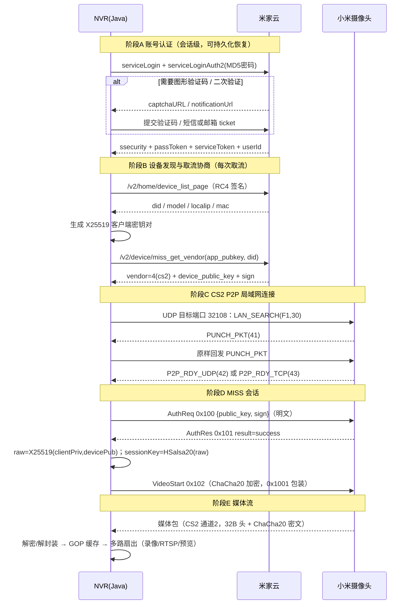
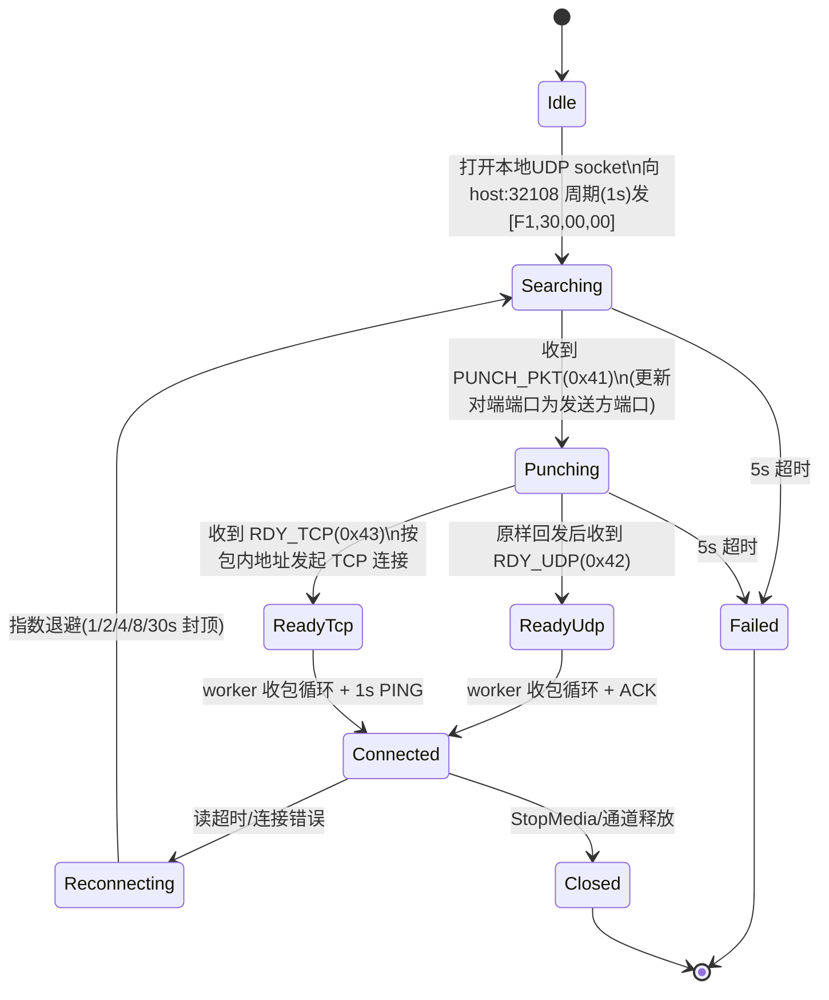

# iNvr 小米摄像头接入详细设计
---

## 1. 协议总览

完整链路分 5 个阶段：



**关键事实**：

- 每次新建取流连接都需要联网访问米家云（获取 vendor 参数、设备公钥与签名）；P2P 连接建立后媒体流在局域网内传输。
- 一台设备同一时刻只建立一条 CS2 连接（单通道复用约束在 StreamHub 层保证）。

---

## 2. 加密体系

### 2.1 云端业务 API：RC4 + SHA1 签名 + nonce

- `ssecurity`：登录后获得（base64），作为业务 API 签名主密钥。
- `nonce`（12 字节）= 8 字节随机数 + 4 字节大端 `unix秒/60`。
- `signedNonce = SHA256(ssecurity || nonce)`（32 字节）。
- RC4：密钥为 `signedNonce`；**每次加解密前先对 1024 字节零缓冲做一次 XOR 并丢弃**（go2rtc `crypt()` 的固定行为），再处理真实数据。
- 请求签名见 4.4。
- Java 注意：JDK 默认禁用 RC4，使用 BouncyCastle `RC4Engine`。

### 2.2 P2P 媒体：X25519 + HSalsa20 + ChaCha20

- 客户端密钥对：X25519（等价 NaCl `box.GenerateKey`），32 字节 public/private。
- **会话密钥（两步派生，务必完整）**：
  1. `rawShared = X25519(clientPrivate, devicePublic)`（32 字节，RFC 7748，内部 clamp）。
  2. `sessionKey = HSalsa20(nonce=16字节0, key=rawShared, sigma="expand 32-byte k")`（32 字节）。

  > ⚠️ **关键坑（M2 真机定位）**：go2rtc `crypto.CalcSharedKey` 调的是 Go `nacl/box.Precompute`，
  > 而 `box.Precompute = curve25519.ScalarMult(...)` **之后还执行了一次
  > `salsa.HSalsa20(out, zeros, out, Sigma)`**。直接把裸 X25519 结果当 ChaCha20 密钥，
  > X25519/ChaCha20 单测都会过、MISS 登录（明文 AuthReq）也正常，但加密 VideoStart 设备解不开、
  > 表现为"登录成功但设备不推 ch2 媒体"。必须补 HSalsa20 这一步。
  > 参考 RFC 7748 §6.1 Alice/Bob：rawShared=`4a5d9d5b…`，HSalsa20 后 sessionKey=`1b275564…`。
  > Java 见 `crypto/HSalsa20.java`（DJB/Go salsa 核心，10 轮 double-round，输出 word 0/5/10/15/6/7/8/9，不回加初始状态）。
- 对称算法：**ChaCha20 流密码（RFC 8439 底层，不带 Poly1305 认证）**。
  - nonce 12 字节布局：`[0..3]=0x00`，`[4..11]=8 字节随机 nonce`；初始 block counter=0。
  - 密文格式：`8 字节 nonce || ciphertext`。
  - Java 推荐 BouncyCastle `ChaCha7539Engine`（可精确控制 12 字节 nonce 布局）；JDK 自带 `ChaCha20-Poly1305` 不适用本场景。

---

## 3. M0：型号锁定与协议验证（先行，1 周内）

### 3.1 前置条件

- 一台 2020 年后的小米/米家摄像头（model 形如 `chuangmi.camera.*`、`isa.camera.*`、`*.cateye.*`、`*.feeder.*`），已绑定米家 App。
- PC 与摄像头同一局域网；一个可登录的米家账号（建议专用小号）。

### 3.2 用参考实现 go2rtc 做基准验证

1. 运行 go2rtc，打开 WebUI → Add → Xiaomi → 账号密码登录（按提示完成图形验证码/短信邮箱验证）。
2. 确认能自动列出目标摄像头并正常播放（即该型号属于 `xiaomi/mess + cs2` 兼容范围）。
3. 记录 go2rtc 生成的源 URL：
   `xiaomi://<userId>:<region>@<localip>?did=<did>&model=<model>&vendor=cs2&...`

### 3.3 抓包要点（Wireshark）

- UDP 目标端口 `32108`：LAN_SEARCH / PUNCH / RDY 握手包。
- RDY 之后的 UDP 数据通道端口（设备侧新端口）；若为 TCP，记录 TCP 三次握手端口。
- 云端 HTTPS 无法直接看明文，以 go2rtc 调试日志与本文档端点为准，不依赖抓包。

### 3.4 验收记录模板（每型号一份）

| 项 | 值 |
|---|---|
| model / did / localip | |
| vendor（应为 4=cs2）/ transport（udp/tcp） | |
| 视频编码（H264/H265）、默认质量档（2 或 3） | |
| 音频编码（PCMA/Opus/无）、采样率 | |
| 双镜头 channel=2 是否需要 | |
| 是否电池/门铃类（需要 wakeup） | |
| go2rtc 播放是否稳定（观察 ≥30 分钟） | |

**M0 出口标准**：至少 1 个型号用 go2rtc 稳定出流 ≥30 分钟，抓包与参数记录完整，作为 Java 实现的对拍基准。

---

## 4. M1：云端认证与设备发现详细设计

### 4.1 端点清单

| 用途 | 方法 | URL |
|---|---|---|
| 登录页（取 qs/_sign/sid/callback） | GET | `https://account.xiaomi.com/pass/serviceLogin?_json=true&sid=xiaomiio` |
| 账号密码登录 | POST | `https://account.xiaomi.com/pass/serviceLoginAuth2` |
| 验证码图片 | GET | `https://account.xiaomi.com<captchaURL>` |
| 2FA 验证方式列表 | GET | `https://account.xiaomi.com/identity/list`（由 notificationUrl 改写） |
| 发送短信/邮箱验证码 | POST | `https://account.xiaomi.com/identity/auth/send{Phone\|Email}Ticket` |
| 校验验证码 | POST | `https://account.xiaomi.com/identity/auth/verify{Phone\|Email}?_flag=<flag>&ticket=<code>&trust=false&_json=true` |
| token 恢复登录 | GET | `serviceLogin?_json=true&sid=xiaomiio`，Cookie `userId=..; passToken=..` |
| 业务 API 基址（cn） | POST | `https://api.io.mi.com/app<apiURL>` |
| 业务 API 基址（其他区） | POST | `https://<region>.api.io.mi.com/app<apiURL>`（region: de/i2/ru/sg/us） |
| 设备列表 | POST | `/v2/home/device_list_page` |
| miss 取流协商 | POST | `/v2/device/miss_get_vendor` |
| 唤醒（门铃/电池机） | POST | `/home/rpc/<did>` |

`sid` 固定为 `xiaomiio`。所有账号接口响应体都带前缀 `&&&START&&&`，解析前先剥离。

### 4.2 密码登录流程

1. GET serviceLogin，解析 `{qs, _sign, sid, callback}`。
2. `hash = upperHex(MD5(password))`。
3. POST serviceLoginAuth2：
   - 表单：`_json=true`、`hash`、`sid`、`callback`、`_sign`、`qs`、`user=<账号>`
   - Cookie：`deviceId=<16位随机字符>`
4. 解析响应 `{ssecurity, passToken, location, captchaURL, notificationUrl}`：
   - `captchaURL` 非空 → 走 4.3 图形验证码；
   - `notificationUrl` 非空 → 走 4.3 二次验证；
   - `location` 非空 → 进入 finishAuth。

### 4.3 验证码与二次验证

**图形验证码**

1. GET captchaURL，响应体为图片字节（返回给前端展示），记录响应 Cookie `ick`。
2. 用户输入后，重新 POST serviceLoginAuth2，表单追加 `captCode=<验证码>`，Cookie 追加 `ick=<ick>`。

**二次验证（2FA）**

1. 把 notificationUrl 中的 `/fe/service/identity/authStart` 替换为 `/identity/list`，GET 之，得 `{code, flag}`（flag=4 手机，flag=8 邮箱），记录 Cookie `identity_session`。
2. POST `send{Phone|Email}Ticket`（表单 `_json=true&icode=<图形验证码，可空>&retry=0`，Cookie identity_session）发送验证码；响应含 `maskedPhone/maskedEmail`，用于前端提示。
3. POST `verify{Phone|Email}?_flag=<flag>&ticket=<验证码>&trust=false&_json=true`，得 `{location}`。

**finishAuth（统一收尾）**

- GET location 并跟随完整重定向链；
- 从各响应 Cookie 提取：`userId`、`cUserId`、`serviceToken`、`passToken`；
- 从响应头 `Extension-Pragma`（JSON）提取 `ssecurity`；
- 组装会话 Cookie 串：`userId=..; cUserId=..; serviceToken=..`。

**持久化与恢复**

- 仅持久化 `userId + passToken`（加密存储，见 4.8）。
- 重启后 LoginWithToken：GET serviceLogin 带 Cookie `userId=..; passToken=..` → 取 ssecurity/location → finishAuth。

### 4.4 业务 API 签名算法（逐步）

对 `POST <baseURL><apiURL>`，参数 JSON 为 `params`：

1. 表单初始 `data = params`；
2. 生成 `nonce`（8 随机 + BE32(now/60)），`signedNonce = SHA256(ssecurity||nonce)`，`b64nonce = base64(signedNonce)`；
3. `rc4_hash__ = base64(SHA1("POST&" + apiURL + "&data=" + data + "&" + b64nonce))`；
4. 用 RC4(signedNonce) 分别加密 `data` 与 `rc4_hash__` 的值，再 base64；
5. `signature = base64(SHA1("POST&" + apiURL + "&data=" + encData + "&rc4_hash__=" + encHash + "&" + b64nonce))`；
6. 最终表单：`data=<encData>&rc4_hash__=<encHash>&signature=<signature>&_nonce=base64(nonce)`；
7. 请求头：`Cookie: <会话Cookie串>`、`Content-Type: application/x-www-form-urlencoded`；
8. 响应：base64 解码 → RC4(signedNonce) 解密 → JSON `{code, message, result}`，`code != 0` 抛业务异常。

### 4.5 设备发现

- API：`/v2/home/device_list_page`，params `{}`。
- `result.list[]` 字段：`did`、`name`、`model`、`mac`、`localip`。
- 摄像头过滤：model 包含 `.camera.`、`.cateye.`、`.feeder.` 任一。
- 电池/门铃类（model 含 `.cateye.`）取流前先唤醒：`/home/rpc/<did>`，params `{"id":1,"method":"wakeup","params":{"video":"1"}}`。

### 4.6 miss 取流协商（每次取流必做）

1. 本地生成 X25519 密钥对 `clientPublic/clientPrivate`（hex）。
2. POST `/v2/device/miss_get_vendor`，params：
   ```json
   {"app_pubkey":"<hex(clientPublic)>","did":"<did>","support_vendors":"TUTK_CS2_MTP"}
   ```
3. 响应：
   ```json
   {"vendor":{"vendor":4,"vendor_params":{"p2p_id":"..."}},
    "public_key":"<设备公钥 hex>","sign":"<签名>"}
   ```
   - vendor 枚举：1=tutk、3=agora、**4=cs2（本项目唯一接受值）**、6=mtp；非 4 直接报"不支持的型号"。
4. 得到 P2P 连接参数集合：`clientPublic/clientPrivate/devicePublic/sign/(p2p_id)`，连同 `localip/model/did` 交给 M2。
5. 若云端返回 `no available vendor support`，说明该型号不走 miss/cs2，本项目不支持。

### 4.7 Java 类设计（M1）

```
com.invr.cloud
├── MiCloudClient          // 登录总入口：login / loginWithCaptcha / loginWithVerify / loginWithToken
├── LoginSession           // userId, passToken, ssecurity, serviceToken, cookie 串
├── LoginChallenge         // 验证码/2FA 中间态（ick、identity_session、flag、maskedPhone/Email、captchaImage）
├── CloudApiSigner         // nonce / signedNonce / RC4 / SHA1 签名与响应解密
├── MiCloudApi             // 业务 API 封装：deviceListPage / missGetVendor / wakeup
├── DeviceDiscovery        // 拉取并过滤摄像头，产出 CameraDevice 列表
└── VendorNegotiator       // 生成密钥对 + miss_get_vendor，产出 P2pConnectParams
com.invr.crypto
├── X25519Keys             // 密钥对生成、sharedSecret（裸 X25519）、calcSharedKey（X25519+HSalsa20）
├── HSalsa20               // box.Precompute 的 HSalsa20 派生（会话密钥第二步）
├── ChaCha20Cipher         // encode/decode（8B nonce 前缀，nonce12=[4零][8随机]，counter=0）
└── Rc4Cipher              // 云端 RC4（含 1024 丢弃）
com.invr.model
├── CameraDevice           // did/name/model/mac/localip/deviceType
├── P2pConnectParams       // did/model/host/vendor/keys/sign
└── CodecProfile           // 视频/音频编码（M2 probe 后回填）
```

关键接口：

```java
public interface MiCloudClient {
    // 密码登录；需要验证码/2FA 时抛 LoginChallengeException（携带 LoginChallenge）
    LoginSession login(String username, String password);
    LoginSession loginWithCaptcha(LoginChallenge c, String captcha);
    LoginSession loginWithVerify(LoginChallenge c, String ticket);
    LoginSession loginWithToken(String userId, String passToken); // 重启恢复
}

public interface DeviceDiscovery {
    List<CameraDevice> listCameras(LoginSession session, String region);
}

public interface VendorNegotiator {
    P2pConnectParams negotiate(LoginSession session, String region, CameraDevice device);
}
```

### 4.8 配置与凭据存储

- **不使用数据库**：账号会话、访问密码、持续录像状态等均以本地文件保存，集中放在**数据目录**下。数据目录由 `store/DataDir` 统一解析，优先级为 `-Dinvr.data.dir=<目录>` 系统属性 → `INVR_DATA_DIR` 环境变量 → 默认**运行目录（`user.dir`，启动 java 的工作目录）下的 `.invr/`**；与录像目录 `recordings/` 一样跟随程序目录，便于整目录迁移 / 容器挂载，不污染用户家目录。
- 数据目录文件：
  - `master.key`：首次运行生成的 32 字节随机主密钥（文件权限尽量收紧为 owner-only，不落库、不进日志）；
  - `session.json`：米家 `LoginSession`（passToken / ssecurity 等）经主密钥 **AES-GCM** 加密（base64，含随机 IV），重启免密恢复；
  - `access.json`：Web 访问密码的 PBKDF2 加盐哈希与 URL 解锁令牌哈希（见 12.8）；
  - `recordings.json`：持续录像期望状态（见 12.10）；CLI 图形验证码临时写 `captcha.jpg`。
- 日志脱敏：did/userId 可记录，passToken/ssecurity/sign/密钥一律不打印。

---

## 5. M2：CS2 P2P + MISS 取流详细设计

### 5.1 CS2 握手状态机



握手细节：

- UDP：本地 bind 随机端口；`WriteUntil` 每秒重发请求直到收到期望类型；**收到回包后用发送方地址更新对端端口**（设备从新端口回话）。
- LAN_SEARCH：`[0xF1, 0x30, 0x00, 0x00]`，期望回包 `[1]==0x41`。
- 将 0x41 回包原样回发，期望 `[1]==0x42`（UDP）或 `0x43`（TCP）。
- TCP 模式地址解析（0x43 包内）：端口 `BE16(b[26:28])`，IP `b[31].b[30].b[29].b[28]`，随后 TCP dial（3s 超时）。
- 总握手超时 5s。

### 5.2 CS2 帧格式

**UDP 外层消息**

| 偏移 | 长度 | 字段 |
|---|---|---|
| 0 | 1 | magic `0xF1` |
| 1 | 1 | type：`0x30` LAN_SEARCH、`0x41` PUNCH、`0x42/43` RDY、`0xD0` DRW 数据、`0xD1` DRW_ACK、`0xE0/E1` PING/PONG、`0xF0/F1` CLOSE |
| 2 | 2 | BE16 size（= 后续总长 + 4） |

**DRW 数据消息（type=0xD0）**

| 偏移 | 长度 | 字段 |
|---|---|---|
| 4 | 1 | magic2 `0xD1` |
| 5 | 1 | channel：**0=命令，2=媒体（下行），3=音频（上行）** |
| 6 | 2 | BE16 seq |
| 8 | 4 | BE32 payloadLen（DataChannel 流内长度前缀，= 后续逻辑消息长度） |
| 12 | 4 | cmd（**发送方向为 BE32**，见下方字节序说明） |
| 16 | n | payload |

> ⚠️ **收发字节序不对称（M2 真机定位，勿回退）**：
> - **发送** marshalCmd：`cmd` 字段写 **BE32**（go2rtc `binary.BigEndian.PutUint32`）。
>   早期误写成 LE32 时，TCP/PING 正常、AuthReq 发出后设备不回 AuthRes、10s 超时。
> - **接收** 设备回令：DataChannel 取出逻辑消息后，其 `cmd` 用 **LE32** 读取（go2rtc ReadCommand LittleEndian）。
> - **流内长度前缀**（offset 8，worker `Push(buf[8:n])` 的 `buf[8:12]`）始终是 **BE32**。
> - 真机样例：AuthRes 内层 `…00000055 00000101(BE) {"result":"success"…}`。

- UDP 可靠传输：收到 DRW 按 seq 处理后回 ACK：
  `[F1,D1,00,06, D1,channel,00,01, seqHI,seqLO]`。
- 命令发送：UDP 下每秒重发一次、最多 5 次，收到对应 ACK 即成功。
- TCP 保活：每 1s 发 `[F1,E0,00,00]` PING（官方 App 行为），收到 PING 回 PONG `[F1,E1,00,00]`。

**TCP 外层帧**

- 接收：先读 8 字节 → `BE16[0:2]=n`、`[2]=0x68`，再读 n 字节负载。
- 发送：`[BE16 len][0x68][6 字节 0][payload]`（共 8+n 字节）。

### 5.3 通道重组（DataChannel）

- 通道 0（命令）：不做乱序缓存，pop 队列容量 10。
- 通道 2（媒体）：乱序缓存 250 个 seq、pop 队列容量 100。
- 重组规则：
  - UDP：按 BE16 seq 用 `int16(seq - waitSeq)` 判断新/旧/未来包；未来包入 map 缓存，连续 seq 依次交付；过去包丢弃。
  - 流内按 **BE32 长度前缀**切分逻辑消息（worker `Push(buf[8:n])`，`buf[8:12]`=BE32 消息长度；一个网络包可含多条消息）。
- 命令读取：channel0 取一条逻辑消息 → **LE32 cmd + body**（注意：仅"读方向"的 cmd 是小端，发送是大端）。
- 媒体读取：channel2 取一条 → 前 32 字节为媒体头，其余为密文 payload。

### 5.4 MISS 会话登录

CS2 连接建立后：

1. 发送 AuthReq（cmd=`0x100`，**明文**，走 CS2 命令通道）：
   ```json
   {"public_key":"<hex(clientPublic)>","sign":"<云端 sign>","uuid":"","support_encrypt":0}
   ```
2. 等待 AuthRes（`0x101`），body 须包含 `"result":"success"`，否则失败。
3. 计算会话密钥：`raw = X25519(clientPrivate, devicePublic)`，`sessionKey = HSalsa20(raw)`（见 2.2，**两步缺一不可**）。
4. 之后所有命令加密发送：
   `outerData = BE32(cmd) + json/body` → `enc = ChaCha20.encode(outerData, sessionKey)`（自带 8B nonce）→ 作为 cmd=`0x1001`(Encoded) 的 body 走 CS2 命令通道。

### 5.5 MISS 命令字表

| 命令 | 值 | 方向 | 说明 |
|---|---|---|---|
| AuthReq/AuthRes | 0x100/0x101 | 双向 | 登录握手（明文） |
| VideoStart/VideoStop | 0x102/0x103 | C→D | 开始/停止视频 |
| AudioStart/AudioStop | 0x104/0x105 | C→D | 开始/停止音频接收 |
| SpeakerStart/Stop | 0x106/0x108 | C→D | 双向语音（一期不做） |
| StreamCtrl Req/Res | 0x109/0x10A | 双向 | 流控 |
| GetAudioFormat Req/Res | 0x10B/0x10C | 双向 | 音频参数 |
| Playback Req/Res | 0x10D/0x10E | 双向 | SD 卡回放（后续） |
| DevInfo Req/Res | 0x110/0x111 | 双向 | 设备信息 |
| Motor Req/Res | 0x112/0x113 | C→D | 云台（后续） |
| Encoded | 0x1001 | C→D | 加密命令包装 |

### 5.6 StartMedia 与质量档

- 主镜头（channel 为空或 0）：
  ```json
  {"videoquality": <q>, "enableaudio": <0|1>}
  ```
- 第二镜头（channel=2）：
  ```json
  {"videoquality": -1, "videoquality2": <q>, "enableaudio": <0|1>}
  ```
- 质量档：`0=auto、1=sd、2=hd（默认）、3=部分新型号的 HD`；M0 记录每个型号的可用档位。已知特例：`chuangmi.camera.046c04`、`chuangmi.camera.72ac1` 默认用 3。
- 发送体：`BE32(0x102) + JSON UTF-8`，按 5.4 加密包装。
- 停止：`BE32(0x103)`。

### 5.7 媒体包格式（CS2 通道 2，32 字节头，小端）

| 偏移 | 长度 | 字段 |
|---|---|---|
| 0 | 4 | length |
| 4 | 4 | codecID：**4=H264，5=H265**，1024=PCM，1026=PCMU，1027=PCMA，1032=Opus |
| 8 | 4 | sequence |
| 12 | 4 | flags（音频采样率：`(flags>>3)&0xF != 0 → 16000Hz，否则 8000Hz`） |
| 16 | 8 | timestamp（**毫秒**，LE uint64） |
| 32 | n | payload（ChaCha20 密文，前 8 字节为 nonce） |

- 解密：`plain = ChaCha20.decode(payload, sessionKey)`（sessionKey 为 2.2 的 HSalsa20 派生结果）。
- 视频 payload 为 **Annex-B** NALU 流（起始码 `00 00 00 01`）；内部使用统一转 AVCC（4 字节长度前缀）。
- 音频：PCMA（G.711A）按字节数累加 RTP 时间戳；Opus 固定 48kHz/双声道、每包 40ms（RTP 时间戳每包 +1920）。
- 视频 RTP 时间戳：90kHz 时钟，`ts = timestampMs * 90`。

### 5.8 Probe 与裸流输出

- StartMedia 后进入 probe（**15s 超时**）：
  - H264：首个含 SPS（NAL type 7）的包 → 解析分辨率/profile/level；
  - H265：首个含 VPS（NAL type 32）的包；
  - 音频：收到 PCMA/Opus 包即确定（不需要音频时可跳过等待）。
- probe 成功后输出 `CodecProfile`，进入持续读流（读超时 10s 触发重连）。
- 输出给 StreamHub 的统一帧：`{codec, isKeyframe, ptsMs, sequence, ByteBuffer(AVCC 或音频)}`。
- 关键帧判定：H264 NAL type=5（IDR）、H265 NAL type=19/20（IDR_W_RADL/IDR_N_LP）；用于 GOP 缓存与新订阅秒开。

### 5.9 M2 真机验证结果（2026-10-10，纯 Java 全链路打通）

- 设备：`did=1190193414`，`model=xiaomi.camera.c302`（"客厅"），LAN `10.10.10.14`，PC `10.10.10.5` 同网段。
- 传输：UDP 32108 打洞 → 设备回 `RDY_TCP(0x43)` → **CS2 over TCP**；登录后设备每 1s PING，客户端回 PONG。
- 编码：**H.265 / Main / 3200×1800 / yuv420p / level 5.0**；音频 **Opus 48kHz / 双声道**。
- 30s 取样：视频 595 包（I 帧 10、P 帧 585，无 B 帧）、4.13 MB；音频 Opus 746 包；落盘 Annex-B `stream-<did>.h265`。
- 校验：`ffprobe` 正确识别 codec/分辨率/profile；`ffmpeg -f null` 全 595 帧解码 **0 错误 0 花屏**。
- 对拍手段：内置 `mockcs2` 参考设备（固定 RFC 7748 Alice 密钥）+ MIT 运行 go2rtc v1.9.14（b5948cf）抓真实帧；
  另提供 `cs2url`（导出 go2rtc URL）、`streamurl`（固定密钥直连，跳过云端协商）两个调试命令。
- 定位并修复的两个致命字节/密钥问题（详见 2.2、5.2）：
  1. marshalCmd 发送 `cmd` 误写 LE32 → 改 **BE32**（改前 AuthReq 后无 AuthRes、10s 超时）；
  2. 会话密钥漏 **HSalsa20** 派生（改前 MISS 登录成功但加密 VideoStart 设备不推 ch2 媒体，15s 超时）。
- 已固化回归：`CryptoTest` 含 RFC 7748 主向量、RFC 8439 零向量，以及 go2rtc 完整 VideoStart 帧
  "X25519→HSalsa20→ChaCha20 解出 `00000102{"videoquality":2,"enableaudio":1}`"端到端向量（全量 23 测试绿）。
- 尚未完成：断流全自动重连、≥30 分钟长稳、第二台 `1182990995@192.168.59.97`（需在该网段）验证。

### 5.10 Java / Netty 类设计（M2）

```
com.invr.p2p.cs2
├── Cs2Connector          // 总入口：connect(host, transport) → Cs2Connection（驱动握手状态机）
├── Cs2Handshaker         // UDP 32108 打洞（LAN_SEARCH/PUNCH/RDY），5s 超时；TCP 地址解析
├── Cs2UdpOuterDecoder    // F1 外层帧解析（Netty Datagram 入站）
├── Cs2UdpOuterEncoder    // F1 帧编码 + DRW 组帧（BE16 size/seq）
├── Cs2TcpFrameCodec      // TCP 8B 头(BE16 len, 0x68) 拆包/封包
├── Cs2AckHandler         // DRW ACK 回复、命令重传（5 次 ×1s）、PING 1s（TCP）
├── DataChannel           // BE32 流内长度前缀重组 + seq 乱序缓存（ch0/ch2 参数不同）
└── Cs2Connection         // readCommand/writeCommand/readPacket，通道 0/2 对外 API
com.invr.miss
├── MissSession           // AuthReq/AuthRes、sharedKey 持有
├── MissCommandCodec      // 命令加密包装（BE32 cmd + body → ChaCha20 → 0x1001）
├── MissPacketDecoder     // 32B 头解析 + payload 解密
├── MissMediaClient       // StartMedia/StopMedia、probe、持续读流 → 统一帧
├── AnnexBConverter       // Annex-B ↔ AVCC、NAL 类型/关键帧判定
└── MissCommands          // 命令字与 JSON 模板常量
```

Netty 落地要点：

- UDP 用 `NioDatagramChannel`：握手阶段对端端口会变化，Decoder 以**入站包 sender 地址**更新远端（对应 go2rtc `addr.Port = addr.Port`）。
- 线程模型：`bossGroup`（网络 IO）+ `mediaGroup`（解密/解封装，CPU 密集独立池）；解密后帧投递 StreamHub。
- 命令请求/响应：`Map<cmd, CompletableFuture>` + 超时；UDP 重传用 `HashedWheelTimer`。
- 内存：`PooledByteBufAllocator` + Direct Buffer；媒体帧对象池化，禁止逐帧 new 大对象（GC 控制）。
- 背压：DataChannel pop 队列满即判定慢消费者，按策略丢非关键帧并计数上报。

### 5.11 重连与保活策略

- 触发条件：握手超时、读流 10s 无包、probe 失败、socket 异常。
- 退避：1s→2s→4s→8s→30s 封顶，加 ±20% 随机抖动。
- 重连顺序：**重新走 miss_get_vendor（每次连接需要新的密钥/签名）→ CS2 握手 → MISS 登录 → StartMedia**。
- 重连成功后 StreamHub 向上推送"流恢复"事件；录像分段在断流处闭合、恢复后新开分段。
- TCP 模式持续 1s PING；UDP 模式依赖 ACK/重传与读超时检测。

---

## 6. Java 工程结构与依赖

```
iNvr/
├── pom.xml
└── src/main/java/com/invr/
    ├── InvrApplication.java
    ├── cloud/          # 4.7
    ├── crypto/         # X25519 / HSalsa20 / ChaCha20 / RC4
    ├── p2p/cs2/        # 5.9
    ├── miss/           # 5.9
    ├── hub/            # StreamHub：单通道、GOP 缓存、扇出、背压（M3）
    ├── recorder/       # MP4 分段录像（M3）
    ├── rtsp/           # 自研 RTSP 输出服务器（M4）
    ├── api/            # REST + 小米账号登录/自动发现/一键添加（M5）
    ├── store/          # SQLite、配置、凭据加密
    └── ops/            # 日志/指标/健康检查
```

依赖（起步）：

| 用途 | 依赖 |
|---|---|
| 网络框架 | Netty（transport / handler） |
| 加密 | BouncyCastle（X25519、ChaCha20、RC4） |
| HTTP 客户端 | OkHttp 或 JDK HttpClient |
| JSON | Jackson |
| 配置存储 | sqlite-jdbc |
| Web/API（M5） | Spring Boot 或 Vert.x |
| MP4 封装（M3） | mp4parser（纯 Java，许可落地时核对）或自研 box 写入 |

---

## 7. 里程碑任务拆解与验收

### M0 型号验证（本文第 3 章）

- [ ] go2rtc 登录并列出摄像头
- [ ] 目标型号稳定播放 ≥30 分钟
- [ ] 抓包与参数记录表完成

### M1 认证与发现

- [x] 密码登录（图形验证码分支未触发，短信 2FA 分支已真机通过）
- [x] 短信/邮箱 2FA 分支（真机 flag=4 手机验证码通过）
- [x] finishAuth 四凭据提取（userId/cUserId/serviceToken/passToken + ssecurity）
- [ ] token 持久化与 LoginWithToken 恢复（passToken 是否落 cookie 待定，见未决项）
- [x] CloudApiSigner：RC4(丢1024)/SHA1/nonce 签名，与参考实现对拍
- [x] device_list_page 拉取并过滤摄像头（真机 30 设备中识别 2 摄像头）
- [x] miss_get_vendor 协商，vendor=4(cs2) 校验
- [x] 凭据 AES-GCM 加密落库、日志脱敏（私钥仅内存）
- **验收**：不依赖 go2rtc，Java 独立完成登录→设备列表→vendor 协商，结果与 go2rtc 一致。

### M2 取流打通

- [x] CS2 UDP 握手（含对端端口更新、5s 超时）
- [x] CS2 TCP 模式 + 1s PING
- [x] DRW 帧解析、ACK、命令 5 次重传
- [x] DataChannel 重组（**BE32** 流内长度前缀 + seq 乱序缓存）
- [x] MISS AuthReq/AuthRes
- [x] X25519 + **HSalsa20** 会话密钥、ChaCha20 命令加密（0x1001，发送 cmd 用 BE32）
- [x] VideoStart + probe（SPS/VPS、音频格式）
- [x] 32B 媒体头解析、payload 解密、Annex-B 落盘
- [x] 输出裸流到文件，ffprobe 识别 + ffmpeg 全帧解码 0 错误（30s/595 帧 H265 3200×1800 + Opus 已验证）
- [x] 断流重连全链路（重新协商→握手→登录→取流，退避首跳 200ms；~110s 固有断流 1s 内恢复）
- [x] 长稳续流验证（130s 跨一次固有断流自动续流、跨重连录像不损坏；更长 soak 见运维观察）
- **验收（M2 出口）**：Java 程序持续取流无花屏/无明显延迟；设备固有 ~110s 断流后自动续流（已达成）。

---

## 8. 风险清单

| 风险 | 影响 | 对策 |
|---|---|---|
| miss/CS2 为非官方协议，随固件/云端变化 | 取流失败 | 协议适配层隔离；M0 先验证；保留 go2rtc 对拍环境 |
| 每次连接依赖云端密钥协商 | 断网无法新建连接 | 文档明示；已建连接保活；云端不可用时给出明确错误 |
| RC4/ChaCha20/X25519 实现细节偏差 | 签名失败/解密花屏 | 严格按第 2 章字节布局；单测固化已知向量（用参考实现抓一组明文/密文对拍） |
| UDP 打洞对端端口变化 | 握手卡死 | 严格按入站包 sender 更新远端地址 |
| 账号风控 | 登录被拦 | 限频、专用账号、不并发多实例登录、凭据加密 |
| GC 停顿影响实时流 | 卡顿 | Direct Buffer + 对象池 + ZGC（M3 压测验证） |
| 许可传染 | 法务风险 | 只翻译 MIT 的 go2rtc；不复制 AGPL 的 MiBeeNVR 代码 |

---

## 9. 参考资料（go2rtc，MIT）

- 模块说明：`internal/xiaomi/README.md`
- 云端登录/签名：`pkg/xiaomi/cloud.go`
- 密钥与加密：`pkg/xiaomi/crypto/crypto.go`
- CS2 连接（握手/帧/通道）：`pkg/xiaomi/miss/cs2/conn.go`
- MISS 客户端（登录/命令/媒体包）：`pkg/xiaomi/miss/client.go`
- 媒体探测与 RTP 输出：`pkg/xiaomi/miss/producer.go`
- 仓库：https://github.com/AlexxIT/go2rtc

---

## 10. M3：StreamHub 单通道扇出 + MP4 分段录像（2026-10-10 真机验收）

### 10.1 单通道扇出（核心硬约束）

同一台摄像头无论被多少消费者同时使用（录像、RTSP 转发、调试裸流），**只占用一条上游 CS2/MISS 连接**。

```
                        ┌─────────── CameraStream（每个 DID 唯一）───────────┐
  RecordingSink   ──▶   │ 引用计数：首订阅拉起唯一上游，末订阅释放            │
  RtspSink(×N)    ──▶   │ 自动重连（重新协商→打洞→MISS登录→VideoStart）      │ ──▶ 一条 CS2/TCP
  AnnexBFileSink  ──▶   │ GOP 缓存（最近 IDR 起，≤16MB）→ 新订阅秒开          │     到摄像头
                        │ 每订阅独立有界队列（1000）+ 独立派发线程            │
                        └──────────────────────────────────────────────────┘
                              ▲ StreamHub（ConcurrentHashMap<did, CameraStream>）
```

- 订阅/退订在该 DID 上用 `ConcurrentHashMap.compute` 原子串行，杜绝"末订阅者移除"与"新订阅者复用"竞争出第二条上游。
- 上游媒体在 `deliverLock` 内串行广播：先回放 GOP（新订阅从最近 IDR 起播），再实时帧；重连时 `onReset(generation)` 通知各 sink，旧代数残留包丢弃。
- 类：`hub/StreamHub`、`hub/CameraStream`、`hub/{MissOpener,StreamSink}`、`cloud/CloudMissOpener`（每次重连重新 `miss_get_vendor`、401 续期）。

**真机实证（`fanout` 命令，录像 sink + 裸流 sink 并发 22s）**：进程内 `activeUpstreamCount()` 全程=1；进程外 `Get-NetTCPConnection` 到 `10.10.10.14` 的 ESTABLISHED TCP 4 次采样恒=1（同一本地端口）；两个 sink 收到的视频包数逐秒一致（444=444）。

### 10.2 周期性断流为设备固有，靠重连兜底（勿再当我方 bug）

真机与 go2rtc v1.9.14 连同一设备，均**每约 110~112s** 断于一字不差的 `cs2: pop buffer is full`（go2rtc `producer.go:170`），go2rtc 断后约 3ms 立即重 dial。jstack 证实断流瞬间设备停发、socket 空、CPU≈0，与日志反压/重组/GC/消费慢无关。

对策（已落地）：自动重连 + 首跳退避 **200ms**（`{200,500,1000,2000,4000,8000,16000,30000}`）+ GOP 从新 IDR 恢复 + 录像时间轴归一化消 gap。真机 130s 录像在 ~110s 断流后 **1s 内**重连续流，跨重连分段不损坏。

### 10.3 媒体时间戳：只取 32 字节头的低 32 位毫秒

真机 dumppkt 证实头 `[16:24]` 的 le64 中**高 4 字节恒为 0xFFFFFFFF（无关字段）**，真实毫秒时钟只在低 32 位（约 49 天回绕）。直接按 le64 解会得到大负数。修复：`ts = Integer.toUnsignedLong(le32(header,16))`；视频约 50ms/帧、音频约 40ms/包，同一时钟。录像器 `normalize()` 处理回绕与重连空洞，保证输出时间轴连续单调。

### 10.4 MP4 分段录像：逐访问单元"自转 AVCC"，不用 demuxer/parser

进程内 bytedeco-ffmpeg 6.1.1（JavaCV）**流拷贝**（不重编码），IDR 边界分段，每段可独立播放。选型踩坑后确定的最终路径：

1. **弃用自定义 AVIO 裸流 demuxer + `avformat_find_stream_info`**：find_stream_info 预读会吞掉部分访问单元，但它们的时间戳已进独立 FIFO，导致输出帧与 ts 错位（每段 duration 虚高成 ~82s、非单调 dts）。
2. **弃用 `av_parser_parse2`**：实测 HEVC parser 在该用法下不导出 hvcC（extradata 恒空）、不填 width/height，且非 COMPLETE_FRAMES 模式会**每两个访问单元只保留一个（丢一半帧）**。
3. **最终：真机已验证每个视频 MissPacket 即一个完整访问单元（包率≈帧率 19~20fps，1:1）**，直接逐包处理：
   - `splitNals` 按 `00 00 00 01 / 00 00 01` 切 NAL；
   - 从 VPS(32)/SPS(33)/PPS(34) 手工组 **hvcC**（H264 取 SPS(7)/PPS(8) 组 **avcC**），PTL 字段直接拷自 SPS；
   - 从 H.265 SPS（去 emulation prevention 后 exp-Golomb 解析）取亮度分辨率（实测 3200×1800）；
   - 剔除参数集 NAL（已进 extradata），其余 NAL 各加 **4 字节 BE32 长度前缀**拼成 AVCC 帧（与 hvcC `lengthSizeMinusOne=3` 一致）；
   - IDR 判定：H265 NAL type 19/20、H264 type 5；
   - 视频 dts 严格单调保护（丢弃流启动偶发的同 ts 冗余副本）。
4. 音频手工 Opus 音轨：OpusHead（family 0，48kHz/2ch）+ 每包裸 Opus 帧，`pts=relMs*48`、`duration=1920`；音视频按 ts 齐平交织（`flushAudio` 不超前）。
5. **内存归属**：所有交给 `codecpar.extradata` 的缓冲必须 `av_mallocz` 分配（交 ffmpeg 所有权）；`avio_closep` 后立即 `outCtx.pb(null)`，避免 `avformat_free_context` 双重释放/挂死。
6. **容器用分片 MP4（fMP4/CMAF），支持边录边播与崩溃保全**：`avformat_write_header` 设 `movflags=frag_keyframe+empty_moov+default_base_moof`——`empty_moov` 把 moov（含 trak / hvcC / avcC / OpusHead / mvex）写到文件头、不依赖结尾 trailer；`frag_keyframe` 每个 IDR(GOP，实测约 3.2s) 输出一个 moof+mdat 并即时落盘。由此：① **正在写入的段也能随时被第二个句柄 / 浏览器打开，播放“已封片”的部分**（读到打开时刻的文件末尾即停，不持续追直播；持续看实时画面走 HLS/RTSP）；② **进程崩溃 / 断电时已封分片仍可解码**，真机强杀验证未封段救回绝大部分、仅丢最后约 1 个 GOP(~3.2s)（普通 MP4 未写 trailer 则整段报废）。可见 / 可 seek 粒度为“已完成的 GOP 分片”：段刚切的头约 3.2s（首个分片封片前）文件可能为空；末尾正在写的分片对 seek 探测会报 `partial file`（顺序播放与已完成分片不受影响），前端对录制中段 seek 预留约一个 GOP 余量。流拷贝、CPU 与普通 MP4 几乎无差（每 GOP 仅多几十字节 moof 头），现代浏览器 / VLC / ffmpeg 均原生支持 fMP4。

### 10.5 真机验收结果

- 50s/20s 分段：3 段，全部 hevc 3200×1800 + Opus 48k/2，视频/音频 duration 与段长一致（22.8/22.2/7.8s），帧数 ~19fps 齐整，`ffmpeg -c copy` 容器时间戳合法，抽帧 PNG 为完整真实画面，无 Invalid NAL / Decoding error。
- 130s/30s 分段（覆盖一次 ~110s 固有断流）：5 段全部 COPY_OK；断流所在段帧数仅少约 1.3s（=重连缺口），跨重连不损坏；重连=1。
- 全量 23 单元测试绿。
- CLI：`record <did> [秒] [分段秒] [目录]`、`fanout <did> [秒]`（单通道自检）。
- 说明：`ffmpeg -f null`（解码经自动 filter）对这种可变帧率（帧间隔 49~79ms 抖动）可能打印个位数 `non monotonically increasing dts` 噪音，但**容器内 packet dts/pts 严格单调、`-c copy` 合法、解码帧完整**，不影响播放。

### 10.6 M3 类设计

```
com.invr.hub
├── StreamHub          // 按 did 管理唯一 CameraStream；compute 原子订阅/退订；activeUpstreamCount()
├── CameraStream      // 引用计数拉起/释放唯一上游、自动重连退避、GOP 缓存、串行广播
├── MissOpener        // 函数式：开一条新上游 MissClient（每次重连重新协商）
├── StreamSink        // onPacket(pkt,gen)/onReset(gen)
└── AnnexBFileSink    // 调试/第二消费者：Annex-B 裸流落盘
com.invr.cloud
└── CloudMissOpener   // miss_get_vendor + CS2 + MISS + VideoStart，401 续期、cateye 唤醒
com.invr.record
├── RecordingSink     // StreamSink：首视频包懒建录像器，视频/音频分发，onReset 计数
└── Mp4SegmentRecorder// 逐 AU 自转 AVCC、手工 hvcC/avcC、SPS 解析分辨率、Opus 音轨、IDR 分段
```

---

## 11. M4：Java 内嵌 RTSP 下行（2026-10-10 真机验收）

### 11.1 形态与边界

- **纯 Java 内嵌**：Netty 仅作 TCP/线程框架，RTSP 信令与 RTP 打包全部手写、随 `invr.jar` 同进程运行，**不外挂 go2rtc/MediaMTX 等独立进程**。
- 仅支持 **RTP-over-TCP interleaved**（`$`+channel+BE16 len+RTP），先单播；视频 interleaved=0-1、音频=2-3。
- URL：`rtsp://<主机>:8554/<did>`；常驻命令 `invr serve [端口=8554]`。
- 数据源**只能**是 `StreamHub.subscribe`：每个播放器连接一个 `RtspStreamSink`，因此 N 个播放器（以及未来同进程录像）对同一 DID 仍只占一条小米 CS2 上游。

### 11.2 信令流程（服务端）

`OPTIONS → DESCRIBE → SETUP(video track0) → SETUP(audio track1) → PLAY → (TEARDOWN/断连)`。

- **DESCRIBE**：按 URL 的 DID 建 `RtspStreamSink` 并 `subscribe`（首客户端会拉起唯一上游），等待 VPS/SPS/PPS（GOP 回放通常很快，冷启动等下一个 IDR，最多 4s），生成带 `sprop-vps/sps/sprop-pps` 的 SDP（H264 用 `sprop-parameter-sets`）。
- **SETUP**：回 `Transport: RTP/AVP/TCP;unicast;interleaved=0-1 / 2-3`，分配 Session。
- **PLAY**：`sink.startPlay()`，先 flush 侧载 GOP（最近 IDR 起，≤4MB）实现秒开，再发实时帧。
- **线程模型**：信令 handler 跑在独立 `DefaultEventExecutorGroup`（DESCRIBE 等待参数集数秒也**不阻塞 Netty IO eventloop** 的 RTP 收发）；RTP 由各 sink 的专属派发线程 `writeAndFlush`，最终在 channel eventloop 出站。
- 自定义 `RtspRequestDecoder`：同一连接上区分 RTSP 文本（CRLFCRLF 结束，处理 Content-Length）与播放器上行的 interleaved 二进制（`0x24` 起，读出后丢弃 RTCP RR）。

### 11.3 RTP 打包

- 视频 **H.265 = RFC 7798**：参数集（VPS/SPS/PPS）与 SEI 聚合为 **AP(type=48)**；大 NAL 用 **FU(type=49)** 分片（FU indicator 复制原 NAL 的 layer/tid 位、替换 type；FU header 的 S/E 位标记首/尾片）；小 VCL NAL 单包直发；同一访问单元共享 RTP 时间戳、仅末包 marker=1。目标 RTP 报文 ≤1400 字节。
- 视频 **H.264 = RFC 6184**：STAP-A(24) 聚合 SPS/PPS，FU-A(28) 分片（代码对称，H264 机型待第二台设备验证）。
- 音频 **Opus = RFC 7587**：每个 40ms 裸 Opus 帧一个 RTP 包，pt=97，marker=1。
- 时钟：视频 90kHz（`ts=relMs*90`）、音频 48kHz（`ts=relMs*48`），音视频共享 `MediaTimeline`（低 32 位毫秒回绕归一、重连不拉大缺口），保证 A/V 同步。
- **只转发 base layer**：H.265 仅下发 `nuh_layer_id==0` 的 NAL。真机扫描发现流中含少量非 base-layer NAL 与拼接边界误切出的高 layer 残片（以及 6 个 1 字节残片），若原样下发播放器会反复报 `Multi-layer HEVC coding is not implemented`；剥离后该警告归零，主画面帧数不受影响。
- **消费者容错**：单个畸形包只计数跳过（`badPackets`），绝不让异常冒泡杀死该订阅的派发线程（M4 初版曾因 1 字节 NAL 导致 `apIndicator265` 越界、派发线程终止、后续全部丢包）。

### 11.4 真机验收结果（xiaomi.camera.c302 @10.10.10.14）

- `ffmpeg -rtsp_transport tcp -i rtsp://127.0.0.1:8554/1190193414 -t 20 -c copy out.mkv`：**exit=0**，385 帧 / duration 20.03s / 实时约 1.1x，hevc **3200×1800** + Opus **48000Hz/2**，抽帧为完整真实画面；`Multi-layer` 警告 0、无丢包/坏包/队列满。
- **单通道实证**：同一 `serve` 进程并发 2 个播放器拉同一 DID，播放期间 3 次采样到 `10.10.10.14` 的 ESTABLISHED 上游 TCP **恒=1（同一本地端口）**，而到 8554 的播放器连接=2，两路产物大小一致（各 1416KB）。
- 全量 **27 单元测试绿**（新增 `RtpPackerTest` 4 项：AP 聚合、FU 分片 S/E 与无损重组、非 base-layer/残片剥离、小 VCL 单包、RTP 头序号/marker）。

### 11.5 M4 类设计

```
com.invr.rtsp
├── RtspServer          // Netty bootstrap：IO worker + 独立业务线程池；端口监听
├── RtspRequestDecoder  // 文本信令 / 0x24 interleaved 二进制复用解帧（上行 RTCP 丢弃）
├── RtspServerHandler   // 每连接信令状态机：OPTIONS/DESCRIBE/SETUP/PLAY/TEARDOWN、SDP、订阅生命周期
├── RtspStreamSink      // StreamSink：取参数集、侧载 GOP 秒开、打包 RTP、interleaved 下发、按包容错
├── RtpPacker           // 纯函数：H265(AP48/FU49)、H264(STAP-A24/FU-A28)、base-layer 过滤
├── RtpEncoder          // RTP 固定头、独立 SSRC/序号
├── MediaTimeline       // 32 位毫秒回绕/重连归一，音视频共享
└── RtspRequest         // RTSP 请求模型（方法/URI/头部/CSeq）
```

### 11.6 后续可选增强（非阻塞）

- RTP over UDP（单播/组播）与 RTCP sender/receiver 报告；当前仅 TCP interleaved，已满足 NVR 内网低丢包场景。
- PAUSE 的真停发/续发、DESCRIBE/PLAY 鉴权（URL token 或 RTSP 401）。
- H264 机型（第二台 `1182990995`）真机验证；PCMA(G.711A) 音频下行（pt=8，时间戳按字节累加）。
- 同进程内置录像调度（`serve` 时对指定 DID 同时挂 `RecordingSink`），把"RTSP+录像单通道"在同一进程端到端固化（M3 的 `fanout` 已证明 hub 对任意 sink 的复用机制成立）。

---

## 12. M5：Spring Boot Web 服务 + 网页全流程控制与预览

### 12.1 形态与边界

把 M1–M4 的纯 Java/CLI 能力封装为**单进程 Spring Boot 服务**（`com.invr.web.NvrWebApplication`），随 `invr.jar` 一起启动，不外挂任何独立流媒体进程：

- 上行：仍仅小米私有 miss/mess + CS2（拒绝 RTSP/ONVIF 上行、拒绝 legacy/TUTK）。
- 下行三路：**网页 HLS 预览**、**RTSP**（M4，Netty 内嵌，`rtsp://host:8554/<did>`）、**MP4 录像**（M3，JavaCV 进程内 remux）。
- 三路与未来任意消费者共享同一个 Spring 单例 `StreamHub`，满足"同一摄像头多消费者只占 1 条上游 CS2 连接"的硬约束（验收见 12.7）。
- 前端为 Spring Boot 内嵌静态单页（无独立前端工程、无构建步骤）：`static/index.html + style.css + app.js + vendor/hls.min.js`。

### 12.2 进程内组件与装配

```
浏览器 ──HLS(hls.js)──▶ HlsController ──▶ HlsService ──▶ HlsSink(每did一个) ┐
VLC/ffmpeg ─RTSP/TCP─▶ RtspServer(Netty,8554) ── RTP sink ────────────────┤
浏览器 ─录像REST──────▶ RecordingController ──▶ RecordingService ──▶ RecordingSink ┤
                                                                      ▼
                                              StreamHub（Spring 单例）
                              ConcurrentHashMap<did, CameraStream>
                                      每 did 唯一上游 CloudMissOpener
                              引用计数首订阅拉起 / 末订阅释放 / 自动重连 / GOP 缓存
                                                                      ▼
                                                    CS2+MISS → 摄像头（1 条连接）
```

- `config/NvrConfig` 以 `@Bean` 暴露 `SessionStore`、`StreamHub`（`destroyMethod=shutdown`）、`RtspServer`；`RtspLifecycle` 用 `@PostConstruct/@PreDestroy` 管理 RTSP 生命周期。
- RTSP 侧在 M5 重构为依赖中立接口 `hub.CameraConnector`（`findDevice(did)` / `openerFor(device)`），Web 下由 `DefaultCameraConnector` 实现（用 `MissCommands.defaultQuality(model)` 建 `CloudMissOpener`），与 CLI 解耦。
- `SessionHolder` 启动时自动加载本地 AES-GCM 会话实现免密；`DeviceCatalog` 缓存设备列表，401 时自动 renew。
- 配置 `application.yml`：`server.port=8080`、`invr.rtsp-port=8554`、`recording-dir=recordings`、`record-segment-sec=120`、`invr.hls.*`（`target-sec=2 / window=6 / idle-sec=25 / audio=true`）。

### 12.3 网页预览为何选 HLS（不选 WebRTC）

- 浏览器不能原生播 RTSP；WebRTC 对 H.265 支持差、需转码，3.5K（3200×1800）软转 CPU 不可接受，故否决。
- 采用 **HLS**：视频 H.265 **原样流拷贝不转码**，仅音频 Opus 解码→AAC 编码（失败自动降级静音）；IDR 边界切片，原生 HLS（Safari/Edge）或 `hls.js` 播放，延迟约一个 GOP（2–4s）。页面同时给出 RTSP 地址供 VLC/ffplay 低延迟兜底。
- **容器用 fMP4(CMAF)，不用 MPEG-TS**：真机对照实验，同一路 HEVC 封进 **MPEG-TS 浏览器黑屏、封进 fMP4 正常出画**。Edge/Safari 原生 HLS 对 fMP4 + HEVC（hvc1）支持最好，而 MPEG-TS + HEVC 兼容性差。产物为 `init.mp4`（hvcC/avcC + esds）+ `seg-N.m4s`（moof/mdat）+ `index.m3u8`。
- 客户端解码要求：H.265 网页播放依赖浏览器 HEVC 能力（Edge/Chrome 需安装「HEVC 视频扩展」，Safari 原生 HLS 支持）。前端对不支持的情况有明确提示（见 12.6）。

### 12.4 HlsSink 关键设计（`hls/HlsSink.java`）

- 每设备一个**持续运行的 ffmpeg hls muxer**（`hls_segment_type=fmp4`、`hls_time=2`、`hls_list_size=6`、`delete_segments+independent_segments`），分片落盘 `<recordingDir>/_hls/<did>/`；空闲 `idle-sec`（默认 25s）内无 m3u8 请求即退订并 purge 目录。整条直播一条连续时间轴，不打 `#EXT-X-DISCONTINUITY`；重连 gap 由 `normalize(devTs)` 归一消除。
- **【核心根因】视频必须喂原始 Annex-B 访问单元，不能手工转 AVCC + hvcC**。最初沿用 MP4 录像的做法（Java 侧把 NAL 剔参数集后转 4 字节长度前缀 AVCC、extradata 挂手工 hvcC），结果 fMP4 分片里 NAL 边界整体错位：checkavcc 客观检出随机/保留 NALU 类型（41/55/57/60/28…）、IDR sample 混入非法 NAL（`[19,41,28]`）、16 字节碎片帧、一个 sample 多个 VCL；ffmpeg 报 `Failed to parse header of NALU`，浏览器 `MEDIA_ERR_DECODE(error3)` 有声音黑屏。三重对照锁定问题：①上游原始包 dump 完全干净（每包恰好一个 VCL，只有 type 1/19/32/33/34）；②同一条流的 MP4 录像（mp4 muxer）严格解码零错误；③ffmpeg 命令行用原始 Annex-B 裸流 `-c copy -f hls -hls_segment_type fmp4` 完全正常。根因是 **hls(fMP4) 的 movenc 对“已手工 AVCC + hvcC”的输入又做了一次 Annex-B→AVCC 误转换**（在长度前缀字节里误找起始码），而 mp4 muxer 不会——两个 muxer 行为不同。
  - **正确做法**：每个视频 packet 直接写**原始 Annex-B AU**（含起始码，IDR 自带 VPS/SPS/PPS，整包一个 sample，不拆帧、不做 NAL 白名单）；`codecpar.extradata` 挂**以起始码 `00 00 00 01` 开头的 Annex-B 参数集**（VPS+SPS+PPS，或 SPS+PPS）。movenc 在 `write_header` 时据此识别为 Annex-B 输入，**自动挂 `hevc_mp4`/`avc` bitstream filter**，自行把参数集生成 hvcC/avcC 写入 init.mp4、把每帧转成 AVCC 写入 mdat。这与 ffmpeg 命令行 `-c copy` 路径完全一致。修复后 `ffmpeg -err_detect explode` 严格解码零错误，checkavcc 每片 sample0=`[32,33,34,19]`、类型直方图仅 `{1,19,32,33,34}`、PROBLEMS=0。
  - **codec_tag 设 `hvc1`/`avc1`**（`MKTAG('h','v','c','1')=0x31637668`、avc1=`0x31637661`）；设 0 会被 ffmpeg 警告 `Stream HEVC is not hvc1`，Safari/Edge 兼容性差。
  - 视频 `time_base=1/1000`、pts=dts=归一化后的毫秒（与 MP4 录像一致；实测 1/90000 也能用但与录像对齐更稳）；冷启动等首个含参数集的 IDR 才 `write_header`，`onReset` 置 `waitKey` 丢弃非 IDR 直到 Hub 侧载的下一个 IDR，保证每片/每次续接都以关键帧开头。
- **音频转码管线跨分片持久复用**（内部类 `AudioPipe`，构造时一次性 open）：Opus 每包 1920 样本（40ms）→ `AVAudioFifo` 凑满 AAC `frame_size=1024` 编码一帧（直接 send 1920 会报 `nb_samples > frame_size`）；AAC 包 pts 为编码器 1/48000 累计样本，写入前 `av_packet_rescale_ts(pkt,1/48000,aStream.time_base())`。音频任意失败 → 全程静音，不影响画面。
- **两个 ffmpeg hls muxer 老坑**：①hls muxer 带 `AVFMT_NOFILE`，playlist/init/分片由其内部 io_open 管理，**绝不能预先 `avio_open` pb**，否则 write_header 失败；②`hls_fmp4_init_filename` 在 Windows 上给绝对路径会被二次拼接成非法路径——**init 给纯 basename `init.mp4`、分片给全路径正斜杠 `…/seg-%d.m4s`、m3u8 给全路径**。

### 12.5 REST 契约

| 方法 | 路径 | 说明 |
| --- | --- | --- |
| GET | `/api/session` | `{loggedIn,userId,region}` |
| POST | `/api/login/start` | `{username,password,region}`，返回分步 stage 与 token |
| GET/POST | `/api/login/{token}/captcha` | 取图形码图片 / 提交图形码 |
| POST | `/api/login/{token}/verify` | 提交短信/邮箱二次验证码 |
| POST | `/api/logout` | 清除米家会话（访问密码保留） |
| GET | `/api/access/status` | 门禁状态 `{configured,unlocked,loggedIn,userId,region}` |
| POST | `/api/access/setup` | 首次设置访问密码（要求米家已登录、未设置过），成功即解锁当前会话 |
| POST | `/api/access/unlock` | 校验访问密码并解锁当前会话（错误返回 401） |
| POST | `/api/access/lock` | 主动锁定，清除本会话解锁态 |
| POST | `/api/access/unlock-link` | 凭访问密码换取一键解锁令牌 `{key,path}`（错误密码 401），不改变当前会话解锁态 |
| GET | `/unlock?key=<令牌>` | 顶层页面（不在 /api 拦截范围）：校验通过置当前会话解锁并 302 到 `/?unlocked=1`，失败 302 到 `/?unlock_error=1`（锁页提示无效） |
| GET | `/api/devices?refresh=` | 设备列表（含 `online/recording/previewing/rtspUrl/hlsUrl`）；`online` 取自米家云 `isOnline`，后台每 60s 自动刷新一次，手动刷新立即更新 |
| GET | `/hls/{did}/index.m3u8`、`/init.mp4`、`/seg-N.m4s` | fMP4(CMAF) HLS 直播（MIME 分别为 `application/vnd.apple.mpegurl`/`video/mp4`/`video/iso.segment`，均无 charset；首次轮询等首片，会话过期 410） |
| POST | `/api/record/{did}/start`、`/stop` | 录像启停（body 可选 `{segmentSec}`，默认 120 即 2 分钟/段，IDR 边界对齐）。**start 即把该 did 写入持续录像期望状态（数据目录 `recordings.json`，默认运行目录 `.invr/`），只有显式 stop 才移除**；服务正常关闭 / 崩溃 / 断电都保留，重启后自动续录（见 12.10） |
| GET | `/api/recordings?did=` | 录像列表；每项含 `recording` 布尔，**仅当前正在写入、尚未封段的那一个文件为 true**，已切完的历史分段与停止录像后的所有段均为 false（由 `Mp4SegmentRecorder.currentSegmentName()` 精确比对文件名，而非按设备是否在录粗判） |
| GET | `/api/recordings/{name}` | inline 回放（`video/mp4`，支持 Range 206 拖动；`?dl=1` 附件下载） |
| GET | `/api/timeline/{did}?date=yyyy-MM-dd` | 时间轴回放：该摄像头当天全部分段按开始时间**升序**，每段含 `name/startMs/durMs/size/recording`；连续会话内段时长取与下一段起点间隔（间隔 ≤300s 视为连续），末段/孤立段按“文件最后修改−起点”估算，正在写入段随时间增长，`recording` 仍仅当前段为 true |
| DELETE | `/api/recordings/{name}` | 删除；`..%2f` 等路径穿越返回 400 |

统一错误体 `{"error":...}`（`GlobalExceptionHandler`）；登录分步状态机由 `AuthService` 以 `CompletableFuture` 串联图形码/2FA 询问，attempt token 有效期 15min。

### 12.6 前端单页要点

- 登录状态机（图形码 + 短信/邮箱 2FA）、设备网格、录像表格、预览模态、回放模态、toast；5s 轮询设备状态。
- **轮询只更新状态徽标/按钮，不重建卡片**（`updateDeviceStates`），按钮事件采用网格级一次性委托，避免轮询导致按钮闪烁与点击中断。
- **在线/离线标识**：设备名旁徽标为绿点“在线”/灰点“离线”（字段 `online`，来自米家云 `isOnline`，`DeviceCatalog` 后台每 60s 自动刷新、手动刷新立即更新）；离线卡片整体置灰并禁用“实时预览/开始录像”（`disabled` 按钮不触发点击），但“停止录像”始终可用（本地操作）。在线态随 5s 轮询经 `applyOnline` 增量更新、不重建卡片；CLI `devices` 表同步增加 ONLINE 列。
- **录像回放（时间轴）**：第三个 tab “录像回放”，选摄像头 + 日期 + 缩放（全天 / 6 小时 / 1 小时；◀▶ 在缩放档平移视窗、全天档翻前/后一天）。时间轴按刻度绘制分段块（青色=已完成、红色脉冲=录制中，连续段最小宽度视觉连成条）；点击任意时刻即定位到所在分段并按段内偏移 seek，点在两段之间空隙则跳到其后最近一段。单个 `<video>` 顺序播放，监听 `ended` 自动加载下一段，实现跨分段连续回放；`timeupdate` 驱动红色游标跟随，1h/6h 档播放点越出视窗自动平移居中。段内精确定位以播放器真实 metadata 为准，时间轴时长仅作导航估算。回放只读本地分段文件，**摄像头离线也能回放历史录像**。录像为 fMP4，**录制中的红色分段也能直接点开播放“已写入部分”**（播到打开时刻的进度为止、不追直播），并轻提示“看实时画面请用实时预览”；点击按命中的视觉块定位（短段被最小宽度撑宽也能点中），刻度/播放游标等装饰层 `pointer-events:none` 且命中用 `elementsFromPoint` 穿透，不会挡住录像块。
- 预览：原生 HLS（Safari/Edge，`canPlayType('application/vnd.apple.mpegurl')`）优先，否则回退 `hls.js`（MSE）；hls.js 处理 `NETWORK_ERROR`（一次 startLoad 重试）、`MEDIA_ERROR`（一次 recoverMediaError，codec 不支持直接提示）。
  - **原生 HLS 冷启动必须先串行预热攒片**：直播 m3u8 无 ENDLIST，若在只有 1 个分片时就赋 `video.src`，原生引擎会直接 `MEDIA_ERR_SRC_NOT_SUPPORTED(error4)` 且不可恢复。前端 `warmHls()` 以 600ms 间隔轮询 m3u8（同时保活 HLS 订阅），**等列表稳定出现 ≥3 个 `.m4s` 分片后才赋 src 并 play**（真机：攒够 3 片后 RS=3、currentTime 正常推进、零 error，直播连续观察 40s+ 稳定）。
  - **MIME 不能被追加 `;charset=UTF-8`**：Tomcat/Spring 默认给 init.mp4/seg.m4s 响应追加 charset 会构成非法 MIME，浏览器 `error4`。需在 `application.yml` 设 `server.servlet.encoding.force-response: false`（保留 `force:true` 仅作用于请求），HlsController 用 `HttpServletResponse.setContentType` 写纯 MIME。
  - 设 **26s 加载看门狗**（预热攒片最坏约 15s + 首片加载/3.5K 软解）：仍无 `videoWidth` 则明确提示"用 Edge + HEVC 扩展，或复制 RTSP 用 VLC"，避免黑屏无反馈。
- CSS 注意：对带 `display:flex` 的类（`.modal-mask/.login-wrap` 等），HTML `hidden` 属性会被作者样式覆盖，需全局 `[hidden]{display:none!important}`。

### 12.7 真机验收结果（xiaomi.camera.c302 @10.10.10.14，H.265 3200×1800 + Opus）

- 启动约 1.2s：Tomcat 8080、RtspServer 8554、HlsService 就绪，自动加载会话免密；fat jar 内 FFmpeg native 经 `requiresUnpack` 正常加载。
- HLS(fMP4)：稳态分片约 3.0s/片、每片 60 sample、sample0=`[32,33,34,19]`；ffprobe 为 hevc 3200×1800(hvc1) + aac 48kHz/2ch；`ffmpeg -err_detect explode` 对 init+分片严格解码零 NALU 错误（360 帧/18s），checkavcc 类型直方图仅 `{1,19,32,33,34}`、PROBLEMS=0；Edge 原生 HLS 实测实时预览连续出画、有声音、currentTime 持续推进、零 error。
- **单通道硬约束**：ffmpeg 拉 HLS + ffmpeg 拉 RTSP + REST 启动 MP4 录像三路并发，多次采样到该设备的 Established TCP **恒为 1（同一本地端口）**，三路均正常产出。
- 录像 REST：列表、inline 回放、`?dl=1` 下载、Range 206 拖动、路径穿越 400 均符合预期。
- 全量 `mvn test`：38 项单测全绿（含 AccessKeyStore 11 项）；浏览器实测登录态/设备列表/模态显隐/预览取流与无 HEVC 时的友好提示均正常。

### 12.8 访问密码门禁（本地 Web 门禁，独立于米家登录）

- **定位与流程**：访问密码是进入 Web 控制台的本地门禁，与米家账号登录相互独立。米家账号登录成功后，若本机尚未设置访问密码，前端强制进入“设置访问密码”页，设置成功才进入系统；此后每次打开系统（新浏览器会话、服务重启、HttpSession 过期）都需输入访问密码解锁。顶栏提供“锁定”，登出米家不清除访问密码。
- **密码存储（`store/AccessKeyStore`）**：不存明文、不可逆。落盘数据目录下的 `access.json`（默认运行目录 `.invr/`，见 4.8），内容为 `{algo,iterations,salt,hash}`：每密码独立 16 字节随机盐，`PBKDF2WithHmacSHA256` 迭代 120000 次派生 256bit，校验用 `MessageDigest.isEqual` 恒定时间比较；密码长度 6–64。文件权限尽量收紧为 owner-only。删除该文件后重启即可重新设置。
- **后端接口（`web/api/AccessController`，`/api/access`）**：`GET status` 返回 `{configured,unlocked,loggedIn,userId,region}`；`POST setup`（要求米家已登录且未设置过，成功后当前会话直接解锁）、`POST unlock`（校验密码，错误 401）、`POST lock`（清除解锁态）。解锁态保存在服务端 `HttpSession` 属性 `invr.unlocked`。
- **强制拦截（`web/config/WebSecurityConfig` + `AccessInterceptor`）**：拦截 `/api/**` 与 `/hls/**`，白名单仅 `/api/access/**`、`/api/login/**`、`/api/session`、`/api/logout`；静态页面/脚本不在拦截路径，保证门禁页本身可加载。未解锁（含“尚未设置密码”阶段）一律返回 `401 {"error":...,"code":"ACCESS_LOCKED"}`。HLS 与录像回放/下载由同源 `<video>`/`<a>` 发起、自动携带 JSESSIONID，解锁后正常、未解锁 401。
- **前端路由（app.js）**：启动 `refreshGate()` 并行拉取 `/api/session` 与 `/api/access/status`，`route()` 按 `configured / unlocked / loggedIn` 三态决策——未配置：米家未登录显登录页、已登录显“设置访问密码”页；已配置未解锁显“输入访问密码”页；已解锁且米家在线进系统。任何受保护接口收到 `401 ACCESS_LOCKED` 自动（去抖）回到门禁页；设置页校验两次一致与最小长度。JSESSIONID 为会话级 Cookie，关闭浏览器或服务重启后需重新解锁。
- **边界**：访问密码只保护 HTTP（API/HLS/录像回放下载）。**RTSP（Netty 8554）是独立协议、不走 HTTP 会话，当前不受此门禁保护**（VLC 直连仍可用），如需可后续为 RTSP 增加 URL token 或用户名密码。
- **URL 一键解锁（`GET /unlock?key=<令牌>`）**：用于把链接存成书签/快捷方式，打开即免输密码进入。
  - 令牌派生（确定性、无随机盐、无需服务端再保管可逆密钥）：`key = Base64URL(SHA-256("invr:url-unlock/v1:" + 访问密码))`，约 43 字符、URL 安全（无 `+/=`）。access.json 中**只存令牌的二次 SHA-256（`urlHash`，标准 base64）**，不落可直接使用的令牌，更不含原密码；校验用 `MessageDigest.isEqual` 恒定时间比较。
  - 入口：锁页输入访问密码后点“生成一键解锁链接”（`POST /api/access/unlock-link`，错误密码 401），前端展示完整 URL 供复制；`UnlockController` 的 `GET /unlock` 校验通过即在当前 HttpSession 置解锁并 302 回首页，失败回 `/?unlock_error=1` 由锁页提示。旧版 access.json（无 `urlHash`）在首次调用 unlock-link 时凭正确密码自动补存（迁移）。
  - **安全边界**：URL query 会进入浏览器历史、书签、代理/访问日志与 Referer，任何持有该链接者在改密码前都可直接解锁，等效长效静态密钥；仅适合受信内网/个人设备书签，**不要外发或暴露公网**。修改访问密码或删除 access.json 后旧链接失效；该链接同样不保护 RTSP。
- **真机验收**：接口层 13 项全过（未配置 status、未锁 devices/HLS 均 401、弱密码 400、setup 200、新会话错密 401/正密 200、lock 后再 401、access.json 无明文）；URL 解锁另验：unlock-link 正密返回令牌/错密 401、新会话 `GET /unlock?key=正确` 302 到 `/?unlocked=1` 且同会话 devices 200、错误 key 302 到 `/?unlock_error=1` 且 devices 仍 401；浏览器实测首次设置页、两次不一致拦截、设置进入、重启后要求解锁、解锁后 HLS 实时预览仍出画、锁定回门禁页、无效链接提示、一键链接直接进系统、锁页生成链接；`AccessKeyStoreTest` 11 项（含令牌确定性/URL 安全、setup 后校验、旧记录迁移与错密拒绝），全量 38 项单测全绿。

### 12.9 已知限制与后续

- H.265 网页播放依赖客户端 HEVC 支持；不支持时用 RTSP/VLC 兜底。HLS 预览延迟约一个 GOP（秒级），不适合超低延迟场景（用 RTSP）。
- 第二台 H.264 机型（`1182990995` @192.168.59.97，需切网段）的 H264 录像 avcC、RTP 打包、HlsSink H264 路径与分辨率解析尚未真机验证。
- 访问密码为 PBKDF2 加盐哈希，防随手查看与离线直读，但不抵抗攻击者拿到整个数据目录（`.invr/`）后对弱口令的高速离线穷举（已强制最小长度 6）；米家会话主密钥目前仍为本地随机主密钥，可后续升级为由访问密码派生（PBKDF2）。
- RTSP 下行暂未纳入访问密码门禁（见 12.8 边界）；面向公网暴露时需自行加网络层访问控制。

### 12.10 持续录像与重启自动恢复

需求：用户一旦对某摄像头点了“开始录像”，此后无论服务正常重启、进程崩溃还是断电，恢复运行后都应**自动继续录像**，无需人工再点一次；只有用户显式“停止录像”才真正取消。采用“**期望状态落盘 + 周期对账自愈**”，而非依赖关机钩子（崩溃时钩子不执行）。

- **期望状态存储（`store/RecordingStateStore`）**：落盘数据目录下的 `recordings.json`（默认运行目录 `.invr/`，见 4.8），内容仅 `{ "<did>": 分段秒数, ... }`（非敏感、不加密）。`RecordingService.start` 在订阅建立后同步 `enable(did, seg)`，`stop` 在确认关闭后 `disable(did)`；写入走“临时文件 + 原子 rename（ATOMIC_MOVE，不支持则 REPLACE_EXISTING）”，崩溃瞬间不会写坏整份状态；文件缺失 / JSON 损坏按“无持续录像”处理而不阻断启动。
- **关机不清除标记**：`RecordingService.stopAll()`（`@PreDestroy`，优雅关闭时关订阅、封段）**不调用 disable**，因此正常关闭与崩溃在状态层面等价——期望标记都保留，重启后一律恢复。
- **对账组件（`web/service/RecordingRecovery`）**：单例守护线程，`ApplicationReadyEvent` 后延迟 3s 首次执行、此后每 20s 一轮。每轮先判断米家会话是否就绪（未登录直接跳过，故“开机自启但尚未登录 / 稍后才登录”两种情形都能在登录后的下一轮恢复），再调 `RecordingService.reconcile()`：遍历期望状态，对“标记要录、当前却没在录”的 did 调 `start(did, seg)` 拉起订阅；设备暂不可达 / 离线 / 未登录等失败只记 debug、不抛错，留待下一轮重试（`StreamHub` 对已建立订阅本身也持续自动重连）；已在录的跳过，天然幂等。单轮整体 `catch Throwable`，避免定时任务因一次异常被 ScheduledExecutor 取消。
- **分段序号跨重启接续（`Mp4SegmentRecorder`）**：构造时按正则 `rec-<did>-NNN-yyyyMMdd-HHmmss.mp4` 扫描录像目录中本摄像头已有段的最大序号，计数器从该最大值起继续，使重启后续录段编号（如 003、004…）与崩溃前连续、不会每轮都从 001 重新开始而与旧段编号重复（文件名另有时间戳兜底防冲突）。
- **与 fMP4 崩溃保全配合**：崩溃瞬间正在写的段因 fMP4 `empty_moov` 已在文件头、每 GOP 即时封片，重启后仍可回放已录部分（仅丢最后约 1 个 GOP，见 10.4 第 6 点）；恢复订阅后另开新段继续，二者共同实现“录像跨重启基本不丢、可持续”。
- **真机验收（隔离 home + 独立录像目录，10s/段）**：① start 后 `recordings.json` 写入 `{"1190193414":10}`，录 2 段后 `Stop-Process -Force` 强杀（模拟断电，状态文件保留）；② 重启第二个实例、**不调用 start**，约 3s 后自动检测标记并恢复订阅、续录出新段，编号从崩溃残留段之后接续（003→004→005，无第二组 001）；③ 显式 `stop` 后状态文件变为 `{ }`，再强杀、重启第三个实例，等待超过一个对账周期（28s）录像目录段数零增长、确认不恢复；④ `RecordingStateStoreTest` 6 项（重启读回、多 did+disable、disable 未知 no-op、缺文件空、损坏 JSON 空且不抛、原子写无 .tmp 残留），全量 44 项单测全绿。
- **边界**：恢复依赖启动后米家会话可恢复（本地加密 session.json 免密）与设备可达；设备离线期间无法取流，恢复订阅会在其上线后经对账 / StreamHub 重连补上，离线时段本身无流可录。CLI 的一次性 `record` 命令不经 Web `RecordingService`，不写也不读该期望状态。


