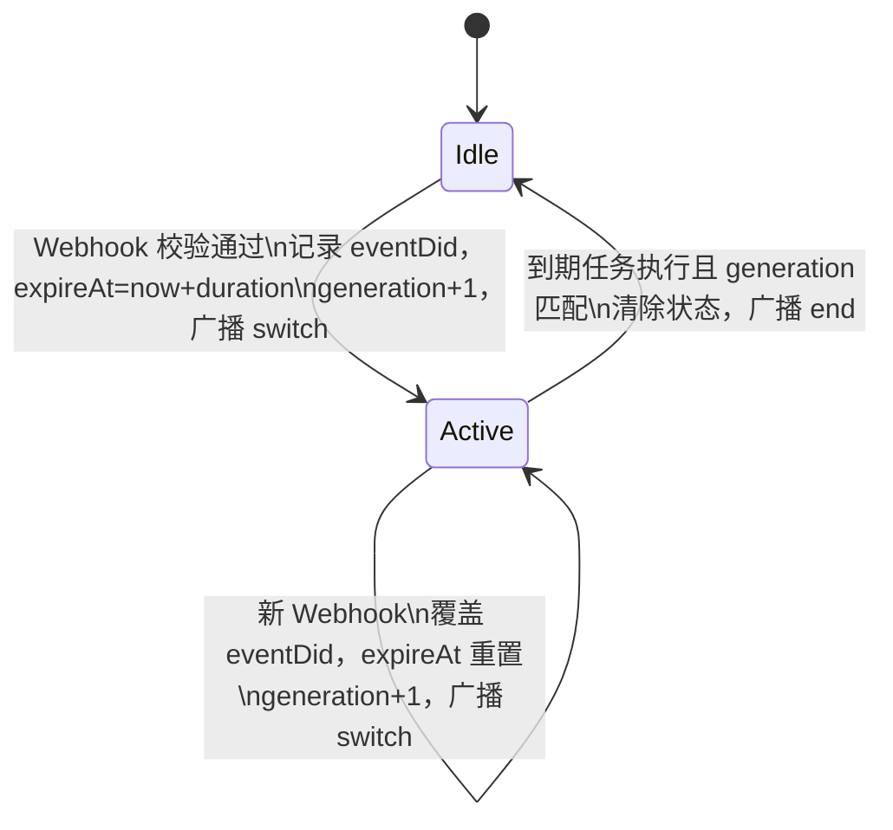
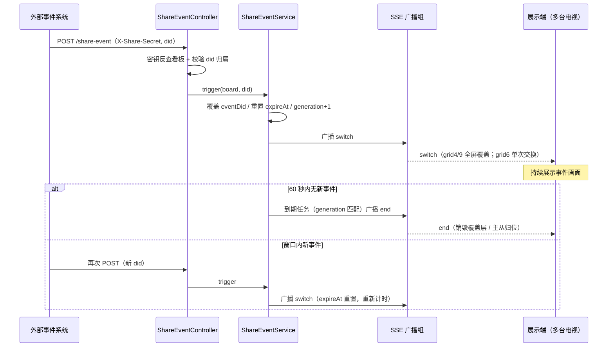

# iNvr 共享看板（多宫格免鉴权展示 + 事件联动）详细设计


***

## 1. 背景与目标

### 1.1 业务场景

现有 Web 预览是 "登录用户在控制台内单画面弹窗"。本功能面向**无人值守的大屏展示**场景，引入三个角色：


| 角色           | 行为                                                                          |
| ------------ | --------------------------------------------------------------------------- |
| **配置者（管理员）** | 在登录态控制台创建 "共享看板"：选择布局（4 / 9 / 1+5 宫格）、按顺序选择摄像头、设置过期时间，生成免鉴权共享链接与 Webhook 密钥 |
| **展示端（使用者）** | Android TV / 普通浏览器打开共享链接，7×24 挂机展示，全程不登录、不操作；同一链接可同时开在多台电视上                 |
| **外部事件系统**   | 某摄像头发生事件时，携带看板独立密钥调用 Webhook，驱动所有展示端临时切换画面，60 秒后自动复原                        |

### 1.2 设计目标与约束


1. **后端媒体链路零侵入**：不新增取流协议、不做服务端混流、视频仍原样透传；全面复用 `StreamHub` 单通道复用与 `HlsService` / `HlsSink`。

2. **免鉴权不等于裸奔**：共享端能力收敛为 "只能看本看板授权范围内的摄像头"，凭高熵随机令牌 + 过期时间 + 可吊销三重控制。

3. **无人值守健壮性**：断流自动重连、SSE 断线重连、页面定时兜底重载、异常状态显示占位而非黑屏。

4. **行为可配置**：事件持续时长、SSE 心跳、兜底重载周期进入 `NvrProperties`，不写死。

5. **控制台内聚管理**：看板的增删改查、启停、密钥轮换、链接复制均在现有门禁内完成。


***

## 2. 整体架构

### 2.1 模块与链路总览


```mermaid
flowchart LR
    ADMIN["配置者（已登录）"] -->|/api/boards/** 受 AccessInterceptor 保护| MCTL["ShareBoardController"]
    MCTL --> SVC["ShareBoardService"]
    SVC --> STORE["ShareBoardStore<br/>boards.json 落盘"]
    SVC --> EV["ShareEventService<br/>事件状态机 + SSE 广播"]

    TV["展示端：Android TV / 浏览器"] -->|GET /share/{token} 免登录| PAGE["SharePageController → share.html"]
    TV -->|GET /share/{token}/board| MCTL2["ShareBoardController(只读)"]
    TV -->|GET /share/{token}/hls/{did}/...| SHLS["ShareHlsController"]
    SHLS --> HLS["HlsService（复用）"]
    HLS --> SINK["HlsSink 单例/每 did"]
    SINK --> HUB["StreamHub 单通道"]
    TV -->|GET /share/{token}/events SSE| EV

    EXT["外部事件系统"] -->|POST /share-event<br/>头 X-Share-Secret| WH["ShareEventController"]
    WH -->|密钥反查看板| EV
    EV -->|switch / end 广播| TV
```

### 2.2 与现有工程的关系


* **复用**：`StreamHub`（引用计数 / 单通道）、`HlsService`（sink 单例 + 空闲 janitor）、`HlsSink`（fMP4 分片）、`hls.min.js`、现有异常体系 `ApiException` / `GlobalExceptionHandler`。

* **新增**：`share` 相关模型、存储、服务、控制器（见第 8 节清单），独立大屏页 `share.html` + `share.js`。

* **改造（最小化）**：`WebSecurityConfig` 无需新增拦截规则（新路径均不在 `/api/**`、`/hls/**` 保护模式内，管理接口走 `/api/**` 自动受保护）；`index.html` / `app.js` 新增 "共享看板" 页签；`NvrProperties` 新增 `share` 配置段。

### 2.3 关键设计决策：共享取流直接复用 HlsService

`HlsService` 的登录校验位于 `HlsController`，其自身方法 `playlist(did)` / `mediaFile(did, name)` 只负责 sink 生命周期与文件读取，**不包含登录判断**。因此 `ShareHlsController` 可直接注入 `HlsService`：


* 同一 did 被管理员预览、多个电视、RTSP、录像同时使用时，仍命中同一个 `HlsSink`，上游仍只有 1 条 CS2；

* 共享 m3u8 内子资源为相对路径（`init.mp4`、`seg-N.m4s`），基于共享 m3u8 的 URL `/share/{token}/hls/{did}/index.m3u8` 自动解析到同目录，**无需像&#x20;**`HlsController`**&#x20;那样注入&#x20;**`?__invr_t=`**&#x20;会话令牌**；

* 共享路径的授权（token 有效性、did 归属）在 `ShareHlsController` 内完成。

禁止另起一套共享专用 sink / 订阅服务 —— 那会造成同 did 双 sink、重复占用上游，违背单通道约束。


***

## 3. 数据模型：共享看板 ShareBoard

### 3.1 字段定义


| 字段                        | 类型        | 说明                                                     |
| ------------------------- | --------- | ------------------------------------------------------ |
| `id`                      | string    | 看板主键，`SecureRandom` 生成的 12 字节 base64url（内部引用，不进共享 URL） |
| `name`                    | string    | 看板名称，便于管理员识别（如 "厂区一楼电视墙"）                              |
| `layout`                  | enum      | `grid4` / `grid9` / `grid6`（1+5）                       |
| `cameras`                 | string\[] | **有序** did 列表，按槽位顺序映射；`grid6` 第 1 路即 BIG 默认主位          |
| `shareToken`              | string    | 32 字节随机数 base64url（约 43 字符，256 bit 熵），出现在共享 URL        |
| `webhookSecret`           | string    | 32 字节随机数 base64url，外部系统请求头携带；与 token 独立生成              |
| `expireAt`                | long?     | 过期时间戳（毫秒），`null` 表示永久有效；到期后页面 / 取流 / SSE/Webhook 全部拒绝  |
| `enabled`                 | boolean   | 启用开关；禁用等价于临时吊销，可重新启用                                   |
| `createdAt` / `updatedAt` | long      | 时间戳                                                    |

### 3.2 持久化：ShareBoardStore


* 落盘位置：数据目录（`DataDir.get()`，默认 `.invr/`）下 `boards.json`，与 `access.json`、`session.json` 同目录。

* 写法对齐现有 store：Jackson `ObjectMapper`（`NON_NULL`）+ pretty JSON，文件权限沿用 `setReadable/setWritable` 收紧；写操作 `synchronized`，先写临时文件再原子替换，避免半写损坏。

* 启动时全量加载到内存 `ConcurrentHashMap<String, ShareBoard>`（按 id 索引），另维护 `shareToken → id`、`webhookSecret → id` 两个反查索引，支撑免鉴权路径与 Webhook 的 O (1) 定位。

* 模型使用纯 POJO（参照 `AccessKeyStore.Record` 风格的公共字段记录类），不引入 JPA。

* 损坏 / 字段缺失的单条记录跳过并告警，不影响其余看板加载。

### 3.3 随机数与比较


* 统一使用 `SecureRandom` 生成令牌与密钥；base64url 且无填充，避免 URL 特殊字符。

* 令牌 / 密钥校验使用 `MessageDigest.isEqual` 恒定时间比较，防止时序侧信道。

* 日志中 token、secret 只打印前 4 位 + `***`，不输出完整值。


***

## 4. 布局模型：轨道 + 槽位配置化

### 4.1 槽位描述

大屏容器固定为 CSS Grid，每个槽位声明网格坐标与跨度，布局切换只换配置、不重建播放器管理框架：


```
Slot { colStart, rowStart, colSpan, rowSpan }
```

### 4.2 三种布局的槽位表

**grid4（2×2 轨道，4 槽，每槽 1×1）**


| 槽位 | colStart | rowStart | colSpan | rowSpan |
| -- | -------- | -------- | ------- | ------- |
| 1  | 1        | 1        | 1       | 1       |
| 2  | 2        | 1        | 1       | 1       |
| 3  | 1        | 2        | 1       | 1       |
| 4  | 2        | 2        | 1       | 1       |

**grid9（3×3 轨道，9 槽，行优先，每槽 1×1）**


| 槽位 | colStart | rowStart | colSpan | rowSpan |
| -- | -------- | -------- | ------- | ------- |
| 1  | 1        | 1        | 1       | 1       |
| 2  | 2        | 1        | 1       | 1       |
| 3  | 3        | 1        | 1       | 1       |
| 4  | 1        | 2        | 1       | 1       |
| 5  | 2        | 2        | 1       | 1       |
| 6  | 3        | 2        | 1       | 1       |
| 7  | 1        | 3        | 1       | 1       |
| 8  | 2        | 3        | 1       | 1       |
| 9  | 3        | 3        | 1       | 1       |

**grid6（3×3 轨道，6 槽，1+5）**


| 槽位      | colStart | rowStart | colSpan | rowSpan |
| ------- | -------- | -------- | ------- | ------- |
| **BIG** | 1        | 1        | **2**   | **2**   |
| S1      | 3        | 1        | 1       | 1       |
| S2      | 3        | 2        | 1       | 1       |
| S3      | 1        | 3        | 1       | 1       |
| S4      | 2        | 3        | 1       | 1       |
| S5      | 3        | 3        | 1       | 1       |

### 4.3 校验规则


* `cameras` 长度必须与布局槽位数一致（grid4=4、grid9=9、grid6=6），且 did 不允许重复；

* 每个 did 必须存在于当前设备目录（`DeviceCatalog`），保存时校验，设备后续离线不影响配置合法性；

* 槽位表在前端与后端各持一份常量（后端用于校验，前端用于渲染），以后端返回的布局类型为准。


***

## 5. 接口设计

所有接口分为四类。除管理接口走现有门禁外，其余路径以 `/share` 开头，不被 `AccessInterceptor` 拦截，由各自控制器完成独立授权。

### 5.1 管理接口（门禁内，`/api/boards/**`）


| 方法     | 路径                               | 说明                                                                   |
| ------ | -------------------------------- | -------------------------------------------------------------------- |
| GET    | `/api/boards`                    | 列出全部看板（含 token/secret，管理员可见）                                         |
| GET    | `/api/boards/{id}`               | 单个看板详情                                                               |
| POST   | `/api/boards`                    | 新建：body `{name, layout, cameras[], expireAt?}`，服务端生成 id/token/secret |
| PUT    | `/api/boards/{id}`               | 更新名称、布局、摄像头、过期时间（**保留原 token/secret 不变**）                            |
| POST   | `/api/boards/{id}/enabled`       | 启用 / 禁用，body `{enabled:false}`                                       |
| POST   | `/api/boards/{id}/rotate-token`  | 重新生成 shareToken，旧链接立即失效                                              |
| POST   | `/api/boards/{id}/rotate-secret` | 重新生成 webhookSecret，外部系统需同步更新                                         |
| DELETE | `/api/boards/{id}`               | 删除看板：落盘移除、关闭该看板全部 SSE 连接                                             |

响应统一为 JSON，错误经 `GlobalExceptionHandler` 转标准错误体；未解锁访问由现有拦截器返回 401 `ACCESS_LOCKED`。

### 5.2 免鉴权展示与取流（`/share/{token}/**`）

**页面入口**


* `GET /share/{token}`：`SharePageController` 校验 token 有效后，`forward` 到静态 `share.html`；token 无效 / 过期 / 禁用返回 410 并渲染简短失效提示页。

**看板配置（只读）**


* `GET /share/{token}/board`：返回展示页渲染所需最小信息：


```
{
  "name": "厂区一楼电视墙",
  "layout": "grid6",
  "slots": [
    {"slot": "BIG", "colStart": 1, "rowStart": 1, "colSpan": 2, "rowSpan": 2,
     "did": "1190193414", "cameraName": "大门", "hlsUrl": "hls/1190193414/index.m3u8"}
  ],
  "serverTime": 1767000000000,
  "expireAt": null
}
```

不返回任何与本看板无关的设备、设置或系统信息。

**共享 HLS 取流**


| 方法  | 路径                                     | 处理                                                         |
| --- | -------------------------------------- | ---------------------------------------------------------- |
| GET | `/share/{token}/hls/{did}/index.m3u8`  | 校验 did 归属后调用 `HlsService.playlist(did)`，原样返回 m3u8（不注入会话令牌） |
| GET | `/share/{token}/hls/{did}/init.mp4`    | 调用 `HlsService.mediaFile(did,"init.mp4")`，`video/mp4`      |
| GET | `/share/{token}/hls/{did}/{seg-N.m4s}` | 同上，`video/iso.segment`                                     |

响应头沿用现有媒体策略：`Cache-Control: no-cache`，Content-Type 纯 MIME 不追加字符集。文件不存在返回 404，由播放器按 HLS 规则重试。

### 5.3 事件 Webhook


* **路径**：`POST /share-event`（不在 `/api/**` 拦截模式内，自行鉴权）。

* **请求头**：`X-Share-Secret: <webhookSecret>`，`Content-Type: application/json`。

* **请求体**：


```
{ "did": "1190193414", "eventType": "motion" }
```

`did` 直接使用小米 did；`eventType` 可选、仅记录日志，不影响切换行为。

**处理逻辑与状态码**


| 情况                     | 响应                                      |
| ---------------------- | --------------------------------------- |
| 密钥有效、看板启用且未过期、did 属于看板 | 200 `{"accepted":true}`，触发 / 刷新事件状态机并广播 |
| 密钥缺失 / 不匹配             | 401 `WEBHOOK_UNAUTHORIZED`              |
| 密钥对应看板已禁用 / 过期 / 删除    | 410 `BOARD_UNAVAILABLE`                 |
| did 不在看板摄像头列表          | 422 `DID_NOT_IN_BOARD`                  |
| body 非法                | 400 `BAD_REQUEST`                       |

Webhook 不区分 "新事件" 与 "窗口内重复事件"，统一交由状态机按覆盖规则处理（见第 6 节）。密钥即看板身份，URL 中不暴露 shareToken，密钥轮换后旧调用立即失效。

### 5.4 SSE 事件推送


* **路径**：`GET /share/{token}/events`，`text/event-stream`，基于 Spring `SseEmitter`（超时设为 0 即不超时，由心跳与清理逻辑维护）。

* **建连握手**：连接建立后立即下发一条快照，保证刷新 / 重连即刻进入正确状态：


```
// 空闲快照
{"type":"snapshot","active":false}
// 事件中快照（剩余秒数由 expireAt - serverTime 计算）
{"type":"snapshot","active":true,"did":"1190193414","expireAt":1767000060000}
```


* **后续广播消息**：


```
{"type":"switch","did":"1190193414","expireAt":1767000060000}
{"type":"end"}
```


* **心跳**：按配置周期发送 SSE 注释帧（`: hb`），防止反向代理 / 电视浏览器空闲断连。

* **清理**：emitter 报错 / 超时 / 完成时从连接集合移除；看板被禁用、删除或过期时主动 `complete()` 全部连接，展示页据此显示占位并尝试重连。

* 一个看板的所有在线 emitter 构成广播组，一次 Webhook 同步送达多台电视。


***

## 6. 事件状态机（核心）

### 6.1 状态定义

后端每个看板维护至多一个活动事件，独立于布局类型：


```
Idle（空闲）
Active { eventDid, expireAt, generation }
```




### 6.2 触发与覆盖规则


1. **Idle → Active**：`trigger(board, did)` 写入活动事件，`expireAt = now + eventDurationSec`，调度到期任务，向广播组发 `switch`。

2. **Active → Active（窗口内新事件）**：**直接覆盖 eventDid、expireAt 重置为 now+duration、generation+1**，再次广播 `switch`；不排队、不叠加。

3. **Active → Idle**：到期任务执行时校验自身 generation 仍为最新（防止被覆盖后的旧任务误清除），匹配则清空状态并广播 `end`。

### 6.3 调度实现


* 使用单例 `ScheduledExecutorService`（核心线程 1，守护线程，命名 `share-event-timer`），每次 trigger 调度一个延迟 `duration` 的到期任务。

* 不做任务取消：任务内通过 generation 比对自动失效，逻辑简单且无竞态。

* 服务关闭时 `shutdownNow`；活动事件为瞬态数据，**不持久化**—— 进程重启后所有看板自然回到 Idle，电视端 SSE 重连会收到空闲快照。

### 6.4 展示端的差异化响应（唯一的布局差异点）

后端消息协议完全统一，布局差异全部收敛在 `share.js`：


| 消息       | grid4 / grid9                               | grid6（1+5）                  |
| -------- | ------------------------------------------- | --------------------------- |
| `switch` | 在网格之上挂载**全屏覆盖层**独立播放 eventDid；底层网格播放器保持存活不动 | 按 "默认布局 + 单次交换" 重新渲染（见 6.5） |
| `end`    | 销毁覆盖层，底层网格无缝恢复                              | 恢复默认映射，主从归位                 |

### 6.5 grid6 的交换规则：基于默认布局单次交换，不做链式叠加


* **默认映射**：`cameras[i]` → 槽位 i（cameras \[0] 占据 BIG），固定不变。

* **事件态渲染**：eventDid 进入 BIG；默认主 did（cameras \[0]）落到 eventDid 的默认槽位；其余槽位不变。

* **连续事件**：无论此前事件把画面交换成什么样，新 `switch` 都**重新基于默认映射**计算一次交换，不基于当前已打乱的状态链式互换。这样任意时刻渲染规则都只是 "默认布局 + eventDid 与主位交换"，不会出现某个 did 无处安放。

* **到期&#x20;**`end`：恢复默认映射 ——eventDid 回到原小格、cameras \[0] 回到 BIG。

* 边界：eventDid 恰为 cameras \[0]（本就在 BIG）时，切换无视觉变化，到期同样无变化。

### 6.6 事件时序





***

## 7. 大屏展示页设计（share.html/share.js/share.css）

### 7.1 页面结构


* 独立精简页面，不加载控制台框架：全屏黑色背景、一个 `#board` 网格容器、一个 `#fullscreenLayer` 覆盖层、一个 `#notice` 状态条。

* 无导航、无管理按钮、无鼠标依赖；覆盖层文字（摄像头名、状态）大字号，适配电视观看距离。

* 复用 `vendor/hls.min.js`；样式独立成 `share.css`，不与控制台 `style.css` 耦合。

### 7.2 播放器多实例管理

现有 `app.js` 的 `state.hls` 是全局单例，大屏页改为映射表：


```
players = Map<slotKey, { did, video, hls }>
```


* `createPlayer(slot, hlsUrl)`：建独立 `<video>`（`muted`、`playsinline`、`object-fit:cover`），封装现有 hls.js 初始化逻辑（原生 HLS 分支与 hls.js 分支、`enableWorker`、错误恢复）。

* `destroyPlayer(slotKey)`：`hls.destroy()` + 清空 `video.src` + 移除 DOM，保证浏览器解码资源与后端引用及时释放。

* grid4/grid9 事件覆盖层独立持有一个临时播放器，`end` 时销毁；grid6 交换不新建播放器，只对槽位与 did 的绑定重新排布（交换槽位上的 video 元素或重新 attach，优先复用实例避免重新缓冲）。

### 7.3 SSE 客户端与本地兜底


* `new EventSource(token + "/events")`：处理 `snapshot` / `switch` / `end`；`onerror` 时浏览器自动重连，额外加退避逻辑（最长 30 秒）并在状态条显示 "连接中断，重连中"。

* 时间基准以服务端 `serverTime` / `expireAt` 为准，避免电视本地时钟漂移；同时本地按 expireAt 设一个兜底计时器，防止 SSE `end` 帧丢失导致画面不恢复（收到下一帧快照时再校准）。

* 事件 did 与当前槽位 did 相同时忽略重复 switch，避免无谓重载。

### 7.4 无人值守健壮性


| 风险             | 处理                                                                                         |
| -------------- | ------------------------------------------------------------------------------------------ |
| 单路断流           | hls.js 网络错误按现有策略 `startLoad` 恢复；媒体错误尝试 `recoverMediaError`，失败在该槽位显示 "取流失败" 占位并定时重试，不影响其他槽位 |
| 设备离线           | 槽位显示 "设备离线" 占位；随配置接口轮询（或 SSE 恢复）在上线后自动起播                                                   |
| SSE 长连失效       | 自动重连 + 快照恢复，无需人工刷新                                                                         |
| 页面整体假死 / 内存膨胀  | 按 `page-reload-sec` 周期 `location.reload()` 兜底（可配置关闭）；reload 后凭快照恢复事件态                      |
| 看板过期 / 吊销 / 禁用 | 接口返回 410 后停止一切重试，全屏显示 "共享已过期或已停用"，避免反复报错                                                   |
| 启动时分片未就绪       | 复用预热轮询思路，m3u8 未就绪时退避重试，首个分片落盘后起播                                                           |

### 7.5 Android TV 兼容性要点


1. **自动播放策略**：电视浏览器普遍要求媒体静音才能自动起播；大屏默认全部静音（音频本就不是电视墙重点），不尝试有声自动播放。

2. **HEVC 支持**：Android 设备 HEVC 硬解通常具备，但浏览器 MSE 内 fMP4/HEVC 支持差异大；真机验证 hls.js 路径，必要时以原生 HLS 或其他兜底，验证结果回写本文档。

3. **EventSource 与长连接**：部分 TV WebView 对长连接回收激进，依赖心跳 + 自动重连；禁用 TV 系统级省电策略属部署说明，不在代码内处理。

4. 分辨率自适应：网格用 `1fr` 弹性轨道 + `vh/vw` 单位，不假设具体电视分辨率。


***

## 8. 类与文件清单

### 8.1 新增 Java 类


| 类                      | 包                      | 职责                                                |
| ---------------------- | ---------------------- | ------------------------------------------------- |
| `ShareBoard`           | `com.invr.model`       | 看板 POJO（含 layout 枚举常量）                            |
| `ShareBoardStore`      | `com.invr.store`       | boards.json 持久化、内存索引、令牌生成与恒定时间比较                  |
| `ShareBoardService`    | `com.invr.web.service` | 看板 CRUD、校验、启停、令牌 / 密钥轮换、过期判定                      |
| `ShareEventService`    | `com.invr.web.service` | 事件状态机、到期调度、SSE 连接管理与广播、快照                         |
| `ShareBoardController` | `com.invr.web.api`     | 管理接口 `/api/boards/**` + 只读 `/share/{token}/board` |
| `SharePageController`  | `com.invr.web.api`     | `GET /share/{token}` 转发 share.html                |
| `ShareHlsController`   | `com.invr.web.api`     | 共享取流，授权后委托 `HlsService`                           |
| `ShareEventController` | `com.invr.web.api`     | Webhook 与 SSE 端点                                  |

### 8.2 新增静态资源


* `static/share.html`、`static/share.js`、`static/share.css`。

### 8.3 修改的现有文件


| 文件                     | 改动                                           |
| ---------------------- | -------------------------------------------- |
| `NvrProperties.java`   | 新增 `Share` 内部配置段（见 8.4）                      |
| `index.html`           | 新增 "共享看板" 页签与看板管理 DOM（列表、新建 / 编辑对话框、复制链接与密钥） |
| `app.js` / `style.css` | 看板管理逻辑与样式；不改动现有预览 / 录像逻辑                     |
| `README.md`            | 功能特性补充共享看板说明（实施完成后）                          |

`WebSecurityConfig` 无需修改：管理接口自动受 `/api/**` 保护，`/share/**` 与 `/share-event` 不在拦截模式内且各自授权。

### 8.4 新增配置项（application.yml `invr.share.*`）


| 配置                   | 默认值  | 说明                          |
| -------------------- | ---- | --------------------------- |
| `event-duration-sec` | 60   | 事件画面持续时长，到期广播 end           |
| `sse-heartbeat-sec`  | 15   | SSE 心跳周期                    |
| `page-reload-sec`    | 3600 | 大屏兜底重载周期，0 关闭               |
| `config-poll-sec`    | 60   | 展示页配置 / 设备状态轮询周期（SSE 之外的兜底） |


***

## 9. 安全考量


1. **令牌熵与不可遍历**：shareToken /webhookSecret 均为 256 bit 随机、base64url，无递增规律，枚举攻击不可行；比较恒定时间。

2. **最小权限**：共享端可访问的路径仅限本看板的配置、本看板 did 的取流与本看板 SSE；任何越权 did、跨看板 token 访问均拒绝。不暴露设备清单、系统设置、录像管理等任何管理能力。

3. **过期与吊销**：`expireAt` 在每次页面、取流、SSE、Webhook 调用时强制校验；吊销 / 禁用 / 删除即时关闭 SSE、失效取流；token 与 secret 可独立轮换，互不影响。

4. **Webhook 防滥用**：无有效密钥不产生任何状态变更；密钥不出现在 URL，降低被代理 / 日志留存的风险；后续可扩展 body 时间戳 + nonce 防重放（一期不做，预留字段）。

5. **信息泄露**：日志脱敏；错误响应不区分 "密钥不存在" 与 "密钥错误" 以外的内部细节；共享配置接口不返回 secret。

6. **传输范围**：功能定位为局域网 / 受信网络内使用，部署文档提示勿将共享端口直接暴露公网；若需跨网，应置于 VPN / 反向代理访问控制之后。

7. **iframe 嵌入**：共享页不强制 `X-Frame-Options`（电视墙集成可能需要 iframe），管理控制台保持默认防护；此为有意差异。


***

## 10. 容量与性能


1. **上游连接数**：活跃 `HlsSink` 数量 = 所有启用看板覆盖的**去重 did 数**（与电视台数、看板数无关）；每个 did 上游始终 1 条 CS2，由 `StreamHub` 保证。

2. **出口带宽**：每台电视独立通过 HTTP 读取同一批分片文件，服务端出口 ≈ 在线电视数 × 单路码率之和；内网环境下按电视数量预估，千兆网可承载数十路主流码率画面。

3. **电视端解码（主要瓶颈）**：grid9 同时 9 路 HEVC 解码对中端 TV 盒子压力大，可能掉帧。一期先真机实测；**预留子码流差异化方案**（grid6 大格高清、小格低清；grid9 全屏低清），子码流能力取决于 `VideoStart` 协商，需在协议侧另行验证后作为二期增强，不在本期范围。

4. **服务端资源**：取流为读文件发送，无额外转码 CPU（仅 HlsSink 既有的音频 AAC 转换）；SSE 连接为长连接、每连接内存占用低；需关注 Tomcat 工作线程与文件句柄在多电视多分片下的余量，交付前压测。

5. **事件覆盖层开销**：grid4/grid9 事件期间 eventDid 多一个解码实例（其底层小格仍在播放），仅持续一个事件周期，结束即释放。

6. **磁盘**：共享预览复用 `_hls` 滑动窗口分片，不产生额外长期占用；janitor 在看板全部下线后自动清理。


***

## 11. 分期实施计划


| 阶段            | 内容                                                                                 | 验收标准                                                               |
| ------------- | ---------------------------------------------------------------------------------- | ------------------------------------------------------------------ |
| **M1 看板管理**   | `ShareBoard` / `ShareBoardStore` / `ShareBoardService` / 管理接口；控制台新增页签与管理 UI        | 可新建 / 编辑 / 删除 / 启停看板、轮换 token 与 secret，重启后配置保留；校验规则生效              |
| **M2 免鉴权展示**  | `SharePageController` / `ShareHlsController` /share 页面骨架与多实例播放器                    | 无登录状态下共享链接可在普通浏览器打开，三种布局正确出画；越权 did 与失效 token 被拒；同一 did 不产生重复 sink |
| **M3 事件联动**   | `ShareEventController` / `ShareEventService` / SSE 通道；前端 switch/end 响应与 grid6 交换逻辑 | Webhook 触发全屏 / 大格切换，窗口内覆盖重置，到期自动复原；多台电视同步；SSE 重连快照恢复正确             |
| **M4 健壮性与实测** | 兜底重载、状态占位、心跳、配置项；Android TV 真机实测、压测、README 更新                                      | 长时间挂机无黑屏 / 假死；过期吊销行为正确；TV 兼容性结论与性能数据回写文档                           |


***

## 12. 风险与待办


| 项        | 说明                                             | 处置                            |
| -------- | ---------------------------------------------- | ----------------------------- |
| 子码流能力未定  | 9 路高清解码可能超 TV 能力，且目前未确认 `VideoStart` 是否支持清晰度协商 | M4 前完成协议验证；不支持则以限制同时路数、硬件选型兜底 |
| TV 浏览器兼容 | 各厂商 WebView 对 MSE/HEVC/SSE 实现差异                | 真机矩阵测试，保留原生 HLS 兜底分支          |
| 外部系统对接   | 对端密钥管理、调用频率与重复上报策略需对齐                          | 提供接口文档与示例；状态机覆盖规则天然容忍重复上报     |
| 公网暴露风险   | 共享链接免鉴权，泄露后在有效期内可被任意观看                         | 强制过期策略、随时吊销、部署侧网络隔离提示         |