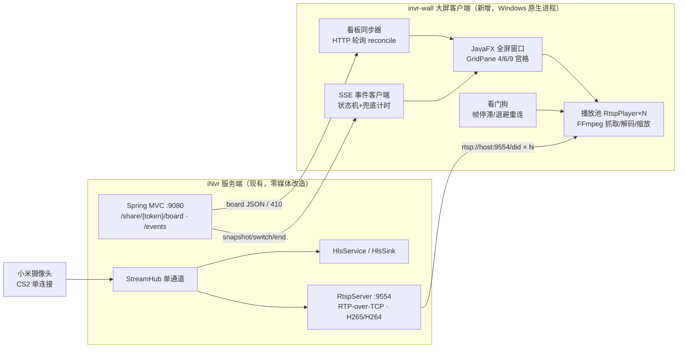
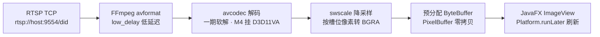
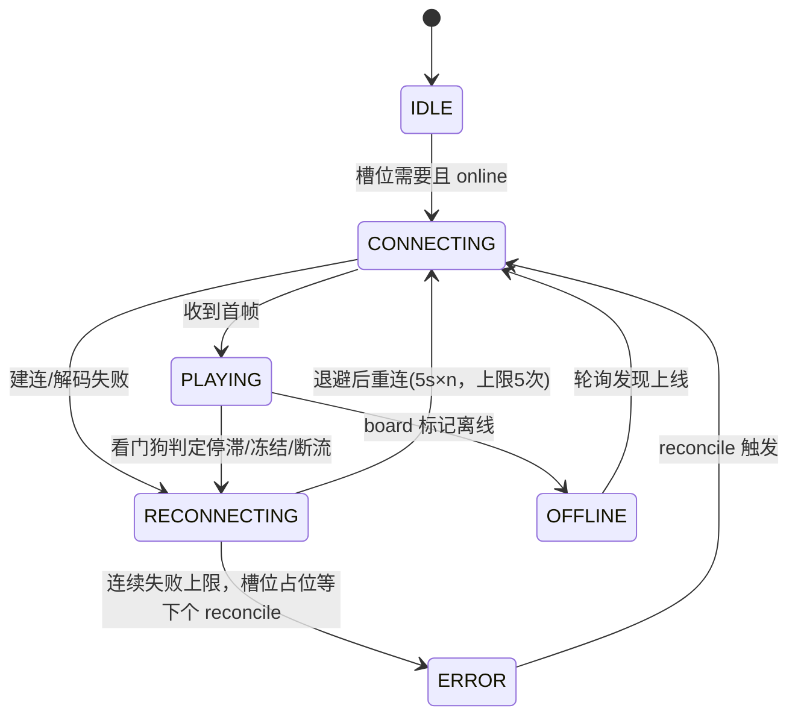

# iNvr RTSP 大屏客户端（共享看板配套 · 低延迟电视墙）方案设计

> 状态：方案评审稿（未写实现代码）
> 定位：共享看板（`02-shared-board-design.md`）的**原生配套展示端**，用 RTSP 直连替代浏览器 HLS，解决 Web 大屏 2–4 秒延迟与 TV 浏览器兼容性问题；看板配置、事件联动完全复用服务端既有能力，不另建管理体系。

---

## 1. 背景与目标

### 1.1 现状与痛点

现有免登录大屏走浏览器 + HLS（fMP4/CMAF）：

- 链路为 `摄像头 → CS2 → StreamHub → HlsSink(3 秒分片 × 窗口 3) → hls.js → <video>`，固有延迟约 **2–4 秒**；
- Android TV / 廉价盒子的 WebView 对 MSE + HEVC 支持差异大，长期挂机存在分片缓冲空洞、内存膨胀、页面假死等问题，目前靠看门狗 + 定时 reload 兜底；
- 9 路 3.5K HEVC 在中端盒子浏览器里解码压力大。

服务端已具备一条更短的下行链路：内嵌 Netty RTSP 服务（默认 9554），RTP-over-TCP 直出 **H.265/H.264 + Opus**，且经 `StreamHub` 单通道复用，与 HLS/录像共用同一条上游。本客户端直接消费该链路。

### 1.2 设计目标

1. **低延迟**：RTSP/TCP 直连 + 极小缓冲，稳态直播延迟目标 **0.5–1.5 秒**（待真机实测），相较 HLS 降低一个数量级；
2. **零配置管理**：管理员只维护现有"共享看板"，客户端输入一次共享链接即可，布局、槽位、摄像头、在线状态、事件全部从 `/share/{token}/board` 与 SSE 读取；
3. **行为与 Web 大屏对齐**：4 / 9 / 6（1 大 5 小）三种布局、事件全屏 / 大格交换、60 秒自动复原、离线 / 空置 / 失效占位、断线重连与看门狗，语义逐一对应 `share.js`；
4. **无人值守**：开机自启、全屏、单实例、崩溃自恢复、7×24 挂机；
5. **服务端近乎零侵入**：不新增媒体链路、不改 RTSP 协议，仅建议在 board 响应中补一个 RTSP 端口字段（见 8.1）。

### 1.3 非目标（一期不做）

- 不做看板管理 / 登录 / 录像回放 / 云台控制等任何管理能力，客户端只读；
- 不做音频输出（电视墙静音展示，与 Web 大屏 `muted` 一致；音频通道在架构上预留，二期再开）；
- 不做多看板轮巡、多分屏布局自定义；一个客户端对应一块屏、一个共享链接；
- 不做服务端混流 / 转码 / 子码流协商（子码流仍是服务端二期待定项）。

---

## 2. 服务端既有契约核实（客户端设计依据）

以下均来自当前源码核实，而非文档转述：

| 项 | 实际实现 | 对客户端的影响 |
| --- | --- | --- |
| RTSP 地址 | `rtsp://<host>:<rtspPort>/<did>`，默认端口 **9554**（`application.yml`，支持运行时 rebind） | 客户端按 did 逐路拼 URL |
| 传输模式 | **仅 RTP-over-TCP interleaved**，无 UDP | FFmpeg 选项强制 `rtsp_transport=tcp`，无需处理 UDP 打洞 |
| 鉴权 | 无（内网信任模型，同 Web 共享定位） | 客户端不需要账号密码；安全边界沿用网络隔离 |
| 视频 | 动态 PT=96，H.265（RFC 7798 打包）或 H.264，90000 时钟；SDP 带 sprop VPS/SPS/PPS | FFmpeg 原生支持，真机机型 c302 为 **H.265 3.5K** |
| 音频 | 动态 PT=97，**Opus/48000/2**，track1 | 一期只 SETUP track0，不发音频 SETUP，服务端允许（video/audio setup 相互独立，PLAY 不强制音频就绪） |
| 首帧 | DESCRIBE 内等待参数集最多 4 秒；sink 侧载 GOP 缓存，PLAY 即推 IDR | 冷启动秒开；客户端 DESCRIBE 超时要放宽到 ≥5 秒 |
| 断流 | 摄像头约分钟级断流，服务端自动重连，重连后等新 IDR 续发 | 客户端表现为短时无帧，靠看门狗超时后整体重连即可恢复 |
| 看板配置 | `GET /share/{token}/board`，返回 `name/layout/slots[]/eventsUrl/serverTime/expireAt/configPollSec/pageReloadSec`；失效返回 **410** | 客户端唯一配置来源；轮询周期用服务端下发值 |
| slot 字段 | `slot`（grid6 为 `BIG/S1..S5`，余为序号串）、`colStart/rowStart/colSpan/rowSpan`、`did`、`cameraName`、`online`；空置槽位 `did=null` | 坐标直接驱动 GridPane；空置不建播放器 |
| 事件通道 | `GET /share/{token}/events`（SSE）：`snapshot`（含 active/did/expireAt）、`switch`、`end`，`: hb` 注释心跳 | 客户端 SSE + 本地 expireAt 兜底计时双保险 |
| 事件规则 | grid4/9 全屏覆盖；grid6 事件 did 与 BIG 默认主位**单次交换**，新事件一律基于默认映射重算；到期复原 | 客户端状态机直接复刻 `share.js` 第 6 节规则 |
| 复用保证 | 同一 did 的 RTSP 连接与 HLS、录像共享同一 `StreamHub` 上游，始终 1 条 CS2 | 客户端 9 路全拉 RTSP 不会倍增摄像头连接数 |

---

## 3. 总体架构

### 3.1 部署视图



### 3.2 与现有工程的关系

- **独立交付，不并入 `invr.jar`**：新建独立 Maven 项目 `invr-wall`（或同仓库子模块），有独立启动入口与打包产物，运行在大屏机而非 NVR 主机；
- 仅依赖服务端公开的 HTTP/SSE/RTSP 契约，不依赖服务端内部类、不读 `.invr/boards.json`；
- 技术栈与主项目对齐：**Java 17 + JavaFX + JavaCV/JavaCPP 1.5.10（FFmpeg 6.1.1，与服务端同版本）+ OkHttp + Jackson + slf4j**，团队无新语言成本，FFmpeg native 双平台打包经验可直接复用。

---

## 4. 技术选型

### 4.1 选型对比

| 方案 | RTSP/H265/Opus 兼容 | 硬解能力 | 技术栈成本 | 结论 |
| --- | --- | --- | --- | --- |
| **JavaFX + JavaCV/FFmpeg** | FFmpeg 全格式支持，TCP/低延迟参数可控 | 可接 D3D11VA/NVDEC，高层 API 偏繁琐 | 与主项目同语言同版本依赖 | **主推（一期）** |
| JavaFX + vlcj(libVLC) | VLC 全格式，开箱即用 | 原生 D3D11 硬解成熟 | 需随包分发 VLC runtime（约 200MB）、JNA 绑定 | 备选（硬解实测不达标时切换） |
| WPF + LibVLCSharp | 成熟 | 成熟 | 引入 .NET 技术栈 | 不选 |
| Electron + 内嵌 ffprobe/mpv | 可行 | 可行 | 进程编排重、内存大、集成杂 | 不选 |
| Android Media3(ExoPlayer) | exo-rtsp 支持 H265，新版含 Opus payload reader | MediaCodec 硬解 | 仅适用于安卓盒子，另立工程 | 平台备选（见 9.2） |
| Qt/C++ + FFmpeg | 最好 | 最好 | 与团队栈不匹配 | 不选 |

选定 **JavaFX + JavaCV** 主线：桌面 Windows 大屏机是默认目标形态，且与现有工程同栈、同 FFmpeg 版本、同 native 打包方式；libVLC 路线作为硬解不达标的 Plan B 保留，播放层已做接口隔离，切换不动上层。

### 4.2 播放管线（每路一路）



关键参数与约束：

- `FFmpegFrameGrabber` 选项：`rtsp_transport=tcp`、`flags=low_delay`、`probesize≈32768`、`analyzeduration≈500000`、`max_delay≈500000`；只订阅视频流（音频 track 不 SETUP），天然绕开 Opus 兼容问题；**真机联调实测禁用 `fflags=nobuffer`**：该选项关闭封装层包缓冲后，本服务端 RTP 承载的 H.265 帧重组丢失参考帧（`Could not find ref with POC`），swscale 输出整片灰屏；
- 解码器另设 `video option threads=1`：FFmpeg 默认按逻辑核数为每路开帧线程，多屏并发时帧线程总数超订阅、互相抢占，实测三路默认线程 60 秒零首帧；限单线程后多路总线程可控，实测本机连 3200×1800 HEVC 单路也能稳定跑满源 ~20fps；
- **必须设 RTSP I/O 读超时 `timeout=3000000`（微秒）**：JavaCV 1.5.10 的 `FFmpegFrameGrabber.start()` 字节码为 `synchronized(avcodec.class){ startUnsafe() }`，即所有 grabber 实例的启动（含 `avformat_find_stream_info`）被一把**类级全局锁串行化**。若某路 RTSP 能连上却收不到视频参数（设备本地 P2P 不通、服务端无视频可下发的死流），其探测会在锁内无限等待，导致同进程其他健康路的 `start()` 全部 BLOCKED、整屏卡在"正在连接"（线程栈实测确认）。设 3s 套接字读超时后，死流在数秒内读超时抛错释放全局锁，健康路即可启动；配合"建连无首帧快速判死"，死路两轮后进 ERROR 不再争锁，稳态下健康路秒开。首帧计时点放在 `start()` 返回之后，避免把全局锁排队时间误计为建连超时；
- 每路一个 daemon 抓取线程，**禁止在 JavaFX UI 线程做任何抓取/转换**；`swscale` 直接输出 BGRA（实测无透明源 alpha 恒为 255），按行整块拷贝进可复用的预分配紧密 `ByteBuffer`（兼容 `imageStride` 行对齐填充），通过 `PixelBuffer::updateBuffer` 刷新 `WritableImage`，不再做 BGR24→BGRA 逐像素 Java 循环；
- 画面填充等价 Web 端 `object-fit: cover`：按容器比例居中裁剪，不露黑边；
- **一律按摄像头原始分辨率拉流，native 不缩放**：grabber 不调用 `setImageWidth/Height`，`swscale` 只做 YUV→BGRA 颜色转换，首帧按真实帧尺寸（实测 3200×1800 / 1920×1080）创建 `PixelBuffer`；到格子的缩放全部交给 `ImageView`（`smooth=true`，GPU 平滑），因此清晰度与格子大小解耦，任意分辨率源流、任意窗口尺寸下都使用源全分辨率位图（单路 BGRA 缓冲约 22MB/8.3MB）。
- **格子分割比例只由布局与窗口决定，与视频分辨率无关**：`GridPane` 用百分比轨道（grid4 为 2×2、grid9/grid6 为 3×3，grid6 BIG 跨 2×2），`boardGrid` 设 `maxSize=MAX_VALUE` 填满根区域；全屏与窗口化都随窗口实时按比例分割，`ImageView` 绑定单元格宽高、`preserveRatio=false` 拉伸填满。舞台最小尺寸限定 **480×270**（16:9 下限），F11 切换全屏/窗口。事件全屏路用独立临时播放器、同样原始分辨率（见 6.3）。
  > 注意：解码与上屏位图均为全分辨率，缩放集中在 GPU；9 路全 3.5K 的软解与内存开销取决于大屏机硬件，硬解与真机多路压测单列 M4。

### 4.3 延迟预算（目标值，待实测校准）

| 环节 | HLS（现状） | RTSP 客户端（目标） |
| --- | --- | --- |
| 服务端分片/打包 | 3 秒分片 + 滑动窗口 | 无分片，RTP 实时下发 |
| 客户端缓冲 | hls.js 窗口 + MSE 缓冲 ≈ 2–4s | 低延迟选项集（不关闭封装缓冲），≤1 个 GOP 抖动缓冲 |
| GOP 起播 | 等分片 | 服务端 GOP 缓存，PLAY 即推 IDR |
| 稳态端到端 | 约 2–4 秒 | **约 0.5–1.5 秒** |
| 冷启动首帧 | 1–3 秒 | 1–3 秒（DESCRIBE 等参数集 + 建连） |

---

## 5. 客户端模块设计

```
com.invr.wall
├── WallApplication.java        # JavaFX 入口：全屏、单实例、异常兜底
├── config/
│   ├── WallConfig.java         # baseUrl、shareToken、rtspPort(可选覆盖)、静音等
│   └── WallConfigStore.java    # exe 同目录 wall-config.json，原子写
├── board/
│   ├── BoardClient.java        # OkHttp 拉 /share/{token}/board，410 判定
│   ├── BoardDto.java           # layout/slots/serverTime/expireAt/轮询周期 DTO
│   └── BoardSyncer.java        # 周期 reconcile（默认 60s，服务端值覆盖）
├── event/
│   ├── SseClient.java          # text/event-stream 流式解析、注释心跳、退避重连
│   └── EventStateMachine.java  # snapshot/switch/end + 本地 expireAt 兜底计时
├── media/
│   ├── RtspPlayer.java         # 单路状态机 IDLE/CONNECTING/PLAYING/RECONNECTING/OFFLINE/FATAL
│   ├── FramePipeline.java      # grab→decode→scale→PixelBuffer
│   └── PlayerPool.java         # did → RtspPlayer 复用/销毁，引用计数随槽位
├── ui/
│   ├── WallStage.java          # StackPane 根：boardGrid + fullscreenLayer + notice + boot
│   ├── GridLayouts.java        # 与服务端 BoardLayouts 同源的坐标常量（以后端下发为准）
│   ├── CellController.java     # 单元格：ImageView + 名称条 + 占位（loading/offline/error/empty）
│   └── Placeholder.java        # 大字号电视向占位
├── watchdog/
│   └── PlayerWatchdog.java     # 帧龄检测、失败计数、指数退避、重连
└── support/
    ├── Clock.java              # 以 serverTime 校准的时钟偏移
    └── LifecycleGuard.java     # 单实例、开机自启注册、崩溃日志滚动
```

### 5.1 启动与配置

1. 首次启动进入极简设置页：粘贴完整共享链接（`http://host:9080/share/{token}`），程序解析出 baseUrl 与 token；也支持高级项手填 RTSP 端口（默认 9554，见 8.1）；
2. 配置落 `wall-config.json`，之后启动直接进全屏大屏；设置页可通过快捷键 / 长按退出调起；
3. 单实例锁（文件锁 / 命名互斥量），避免开机自启重复拉起。

### 5.2 看板同步（对应 share.js reconcile）

- 启动先拉一次 board：410 → 进入 FATAL 全屏"共享看板不可用、已过期或已停用"，**停止一切重试**；网络错误 → 5 秒退避重试；
- 按 `slots[]` 坐标渲染 GridPane，每个槽位绑定 did；`did=null` 显示"空置"，不创建播放器；
- 之后按服务端下发的 `configPollSec`（默认 60s）轮询：
  - `online` 变 false → 停连并显示"设备离线"；变 true → 重新起播；
  - 槽位 did 变化 → 销毁旧播放器、建新播放器；**事件进行中跳过 did 替换**，end 后下一周期处理（与 Web 端一致）；
  - layout 变化 / 槽位数变化 → 整体重渲染；
  - 轮询失败保留现状，下一周期再试。

### 5.3 播放器状态机与看门狗



- 看门狗语义对齐 `watchdog.js`：抓取线程记录最近一帧的墙钟时间，**帧龄 > 10 秒判定冻结**、连接异常立即判定；动作是 teardown + 重建整路 grabber（等价 Web 端 remount），连续失败 5 次进入 ERROR 占位，退避基数 5 秒线性递增；
- **建连后无首帧单独快速判死**：若一轮会话 RTSP 建连成功却始终拿不到首帧（典型为设备本地 P2P 链路不通、服务端无上游视频包可下发，但 RTSP 端口本身可用），按独立 `noFrameFails` 计数，退避 5 秒重试，连续 2 次（约 45 秒内）即进 ERROR 占位，不再让 grabber 反复空连忙等、抢占资源拖慢同屏健康路；ERROR 后仍由 60 秒 board 轮询 reconcile 与 F5 手动刷新自动恢复；
- 重连只影响单路，其他槽位不受影响；重连后服务端 GOP 缓存保证新 IDR 快速到达；
- 播放器实例按 did 复用：grid6 交换槽位只搬 UI 节点、不重建取流；事件全屏路复用池中已存在 did 的实例，池中没有才新建。

### 5.4 SSE 事件客户端

- OkHttp 长连接流式读取 `text/event-stream`，自行按 SSE 帧格式切分（含 `: hb` 注释心跳忽略）；断线指数退避重连，上限 30 秒，状态栏提示"事件连接中断，重连中"；
- 消息处理与服务端状态机一一对应：
  - `snapshot`：重连/启动即校准，active=true 则直接进入事件态（带剩余时长），false 则复原；
  - `switch{did,expireAt}`：先还原上一事件，再按当前布局应用新事件；
  - `end`：立即复原；
- **本地兜底计时**：用 `serverTime` 校准本地时钟偏移，按 `expireAt` 本地同步挂计时器，SSE end 帧丢失也能准时复原；收到下一帧 snapshot 时再校准；
- 同一 did 的重复 switch 忽略，不做无谓重建。

### 5.5 三种布局与事件呈现

坐标完全采信 board 下发（`GridLayouts` 仅做兜底常量）：

- **grid4（2×2）/ grid9（3×3）**：事件触发时在根 StackPane 顶层 `fullscreenLayer` 新建/复用一路全屏播放器，底层网格播放器全部保持存活；end 销毁覆盖层；
- **grid6（BIG 2×2 + S1..S5）**：事件 did 进 BIG，默认主 did（cameras[0]）落到事件 did 的原槽位，其余不动；每次 switch 都**先恢复默认映射再算一次交换**，不做链式叠加；JavaFX 实现为节点 reparent + GridPane 约束重设，播放器实例不重建；
- 边界：事件 did 即 BIG 主位时无视觉变化；空置槽位 did 不会出现在事件中（服务端已校验 did 归属）。

---

## 6. 无人值守与运维设计

### 6.1 健壮性对照（与 Web 大屏逐项对齐）

| 风险 | Web 端做法 | 客户端做法 |
| --- | --- | --- |
| 单路断流 | hls.js startLoad / remount | 看门狗 teardown 重建 grabber，单路隔离 |
| 设备离线 | 占位 + 轮询恢复 | board.online 驱动停连/起播，槽位"设备离线"占位 |
| SSE 失效 | EventSource 自动重连 | OkHttp 流重连 + 退避 + 快照恢复 |
| 进程假死/内存膨胀 | 3600s 定时 reload | JVM 内定时回收失活播放器缓冲；外置守护进程定时健康检查（见 6.2） |
| 看板过期/吊销/禁用 | 410 停重试 | 同样 410 FATAL，全屏提示，不发起任何取流 |
| 启动时参数集未就绪 | m3u8 退避轮询 | DESCRIBE 5s+ 超时容忍，CONNECTING 占位"正在连接…" |
| 时钟漂移 | serverTime/expireAt 校准 | Clock 维护 server-local 偏移，兜底计时以此为准 |

### 6.2 进程守护与部署

- jpackage 产出 Windows 应用目录 / msi：内含裁剪后的 JRE 与 `ffmpeg windows-x86_64` native（JavaCPP 运行时自动加载，目标机免装 FFmpeg）；
- 开机自启：首选任务计划程序（At log on、失败重启策略、无需用户登录可配），备选启动文件夹快捷方式；
- 守护：外层轻量 watchdog 批处理/任务计划定期探测窗口存活与日志心跳，消失则拉起；Java 内设置全局未捕获异常处理器，异常时落日志并退出 nonzero 交守护重启；
- 日志：slf4j-simple 本地按天滚动，记录每路连接、重连、帧停滞、SSE 状态，脱敏（不打印完整 token）；
- 显示：默认全屏黑底、无边框、禁止休眠与屏保（JNI/电源命令或部署说明），适配任意分辨率（GridPane 弹性轨道 + vh/vw 等价约束）。

---

## 7. 安全考量

1. 客户端能力收敛为只读：仅出站访问 `/share/{token}/board`、`/share/{token}/events` 与 RTSP 9554，不含任何管理接口调用；
2. shareToken 本地配置文件落盘，参考服务端 store 做法限制文件权限；日志只打印 token 前 4 位；
3. **既有事实需知悉**：RTSP 端口本身无鉴权，知道 did 即可拉流——本客户端不扩大该面（did 从授权 board 响应获得，不枚举），部署仍限定局域网 / VPN / 受信网络，不透公网；
4. 410 / token 轮换 / 看板禁用后，客户端在下一次 board 拉取或 SSE 断连后进入 FATAL，不再重连 RTSP（已建连接随服务端关闭而断，看门狗不再重建）。

---

## 8. 服务端配套改动评估

### 8.1 建议的最小改动（1 处，几行代码）

`SharePageController.board()` 当前不下发 RTSP 端口，而 RTSP 端口可运行时 rebind、且默认值曾在 8554/9554 间调整。建议在 board 响应中补充：

```json
"rtsp": { "host": "<请求Host中的主机>", "port": 9554 }
```

或直接每槽下发 `"rtspUrl": "rtsp://host:9554/<did>"`。客户端据此拼 URL，端口变更零人工干预；Web 大屏忽略新字段，行为不变。

- 改动范围：`SharePageController` 一个方法内追加字段 + DTO 注释；不改接口路径、不改鉴权、不改 RTSP 服务；
- 兼容策略：客户端发现字段缺失时回退到"baseUrl 主机 + 本地配置端口（默认 9554）"，因此**该改动不是客户端开发的硬前置**，可并行实施。

### 8.2 明确不需要的改动

- 不需要为 RTSP 增加 token 鉴权（一期沿用内网信任模型；若未来要加，建议 RTSP URL 带短期签名参数，另立方案）；
- 不需要新增加密、转码、混音或子码流；
- 不需要新增事件接口（SSE 协议原样复用）。

---

## 9. 风险与待确认项

### 9.1 主要技术风险

| 风险 | 说明 | 处置 |
| --- | --- | --- |
| **9 路 3.5K H.265 解码性能** | 软解 9 路全分辨率 H.265 大概率超中端 CPU 能力；小格缩放只省渲染不省解码 | M1 即做基准压测；M4 上 D3D11VA/NVDEC 硬解（JavaCV AVHWFrames 映射）；不达标则切 libVLC 方案或推动服务端子码流 |
| JavaCV 硬解集成复杂度 | 高层 API 对硬件帧上下文封装薄，需手动处理 hwframe transfer | 播放层接口隔离（FramePipeline），软/硬解可替换；预留 vlcj 实现 |
| 长时间挂机稳定性 | FFmpeg 抓取线程泄漏、native 内存膨胀 | 预分配缓冲复用、播放器重建时严格 release 所有 AV 资源、native 内存计数日志、守护进程兜底 |
| 事件全屏额外一路解码 | grid4/9 事件期同 did 可能同时存在小格 + 全屏两个解码实例 | 优先复用池中实例；复用不了时接受一个事件周期的额外开销（同 Web 端语义），end 即释放 |
| RTSP 仅 TCP | 网络抖动时 TCP 重传会导致延迟累积 | 看门狗检测帧龄/延迟超限后直接重建连接追 live，而不是无限缓冲 |
| 二期开音频 | Opus over RTSP 属非标准常见组合，JavaCV/FFmpeg 可解但需验证唇同步 | 架构预留 track1；一期静音不阻塞交付 |

### 9.2 待确认（评审时敲定，不阻塞本方案）

1. **大屏机形态与硬件**：Windows x86 迷你主机 / 工控机（本方案默认）还是 Android TV 盒子？若为安卓，改走 Media3(exo-rtsp) 独立工程，DTO 与状态机设计仍可共用；请提供大屏机 CPU 型号、是否有独显 / 核显世代，用于判定 9 路硬解路线；
2. **是否需要声音**：一期默认静音（只拉视频 track0），确认可接受；
3. **8.1 的 board 增补 `rtsp` 字段**是否采纳（推荐采纳，客户端带回退逻辑，无耦合风险）；
4. 一块屏是否固定一个看板链接、无需多看板轮巡（一期按此假设）。

---

## 10. 分期实施计划

| 阶段 | 内容 | 验收标准 |
| --- | --- | --- |
| **M1 骨架与单路播放** | 工程搭建、配置页、board 拉取与 DTO、RtspPlayer 软解单路、JavaFX ImageView 上屏、4 宫格 | 输入共享链接后 4 路出画；稳态延迟实测留档；断网/停服有占位与重试 |
| **M2 全布局与健壮性** | grid6/grid9、坐标渲染、空置/离线占位、PlayerPool 复用、看门狗退避重连、reconcile 热更新、jpackage 打包 + 开机自启 | 三布局正确；单路故障不影响其他；重启后自动进入大屏；连续挂机 24h 无黑屏假死 |
| **M3 事件联动** | SSE 客户端、snapshot 校准、grid4/9 覆盖层、grid6 单次交换、本地兜底计时、中断重连 | Webhook 触发与 Web 大屏行为一致：全屏/进大格、覆盖重置、到期复原；断 SSE 后兜底计时仍准 |
| **M4 性能与长稳** | 9 路压测、D3D11VA/NVDEC 硬解或 libVLC 备选、守护进程、日志与部署文档、服务端 rtsp 字段联调 | 目标硬件 9 路持续挂机 CPU/GPU/内存数据达标；7×24 稳定性观察；延迟与恢复时长指标回写本文档 |

---

## 11. 关键协议速查（实现时直接引用）

- 看板：`GET http://<host>:9080/share/<token>/board` → 200 JSON / 410 失效
- 事件：`GET http://<host>:9080/share/<token>/events` → `text/event-stream`
  - `{"type":"snapshot","active":false}` / `{"type":"snapshot","active":true,"did":"...","expireAt":<ms>}`
  - `{"type":"switch","did":"...","expireAt":<ms>}` / `{"type":"end"}`
- 取流：`rtsp://<host>:9554/<did>`，仅 TCP interleaved；track0=视频(PT96 H265/H264)，track1=音频(PT97 Opus)，一期只 SETUP track0
- 布局坐标权威来源：board 响应 slots 的 `colStart/rowStart/colSpan/rowSpan`（3×3 轨道；grid4 为 2×2）
- 轮询 / 事件周期：以 board 响应的 `configPollSec` 与事件消息 `expireAt` 为准，不写死
